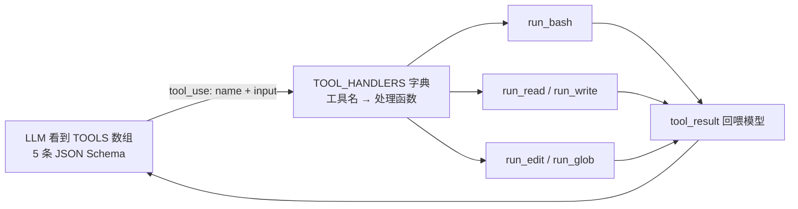

# s02 Tool Use — 多加一个工具，只加一行

> 📖 《Learn Claude Code》章节笔记｜[← 返回主笔记](../笔记.md)｜状态：✅ 已完成（2026-10-14）

## 一、本章讲了什么（充分展开，讲透为止）

### 1. 本章要解决的问题

s01 的 agent 只有一个 bash 工具。模型想的是"读这个文件"，却必须把意图翻译成 `cat path/to/file`；写文件要拼 `echo "..." > file.py`，改文件要构造 `sed` 命令。问题有三层：

- **多一层翻译**：模型的自然意图（读/写/改/找）和唯一表达手段（shell 命令）之间有落差，每次都要消耗生成能力去拼命令；
- **浪费 token**：`echo` 一个 200 行文件，内容要在 bash 命令字符串里转义一遍，又丑又占上下文；
- **容易拼错**：转义、引号、路径，任何一处出错都要浪费一轮循环去纠错。

### 2. 核心方案：工具分发（Dispatch Map）

方案是经典的**查表分发**模式，两步扩展一个工具：

1. **定义工具**：在 `TOOLS` 数组加一条 JSON Schema（name/description/input_schema）——这是给模型看的"能力清单"；
2. **注册处理函数**：在 `TOOL_HANDLERS` 字典加一行 `工具名 → 函数` 映射——这是给 harness 看的"执行路由"。

循环本体（LLM 调用、tool_use 判断、结果回喂）**一行没改**，唯一变动是把 s01 硬编码的 `run_bash(block.input["command"])` 换成 `TOOL_HANDLERS[block.name](**block.input)`。

**🖼️ 机制图（这张图怎么看——左半是"给模型看的能力清单"，右半是"给 harness 看的执行路由"，两者靠工具名这个字符串对齐）**



### 3. 代码走读（code.py，206 行）

**分发机制**：
```python
handler = TOOL_HANDLERS.get(block.name)
output = handler(**block.input) if handler else f"Unknown: {block.name}"
```
`**block.input` 把模型给的 JSON 参数直接展开为函数关键字参数——工具定义里的 schema 和 Python 函数签名因此必须严格对齐。未知工具名不崩，返回 `Unknown:` 文本让模型知道自己"叫错名字了"。

**五个新工具各藏一个设计细节**：

- `read_file(path, limit)`：`limit` 参数 + `... (N more lines)` 的截断提示——**主动告诉模型"还有更多，要就再要"**，这是 token 效率意识；
- `write_file(path, content)`：自动 `mkdir(parents=True)`——模型不用先想"目录存不存在"，减少一个失败点；
- `edit_file(old_text, new_text)`：`replace(old, new, 1)` **只替换第一处** + 找不到时返回 `Error: text not found`——精确替换避免了 sed 式的误伤，也是 Claude Code 真实 Edit 工具的雏形；
- `glob(pattern)`：结果去重排序、截断 200 条，超出时附言 `narrow the pattern`——**工具返回值里直接教模型下一步该怎么做**；
- `safe_path()`：`resolve()` 后校验 `is_relative_to(WORKDIR)`，路径逃逸直接拒绝——file tools 被关进工作目录，**但注意 bash 不受此限制**（本章结尾自己点破，这是 s03 的引线）。

**最容易被忽略但最重要的设计哲学——错误处理**：所有工具出错都不抛异常，而是返回 `"Error: ..."` 字符串。为什么？因为异常会炸掉循环，而**返回错误文本是把错误变成上下文**——模型读到 "text not found" 会自己换个 old_text 重试，读到 "Path escapes workspace" 会改用相对路径。Agent 的鲁棒性不来自"不出错"，来自"错误也参与推理"。

### 4. 相对 s01 的变更（作者给的 diff 表）

| 组件 | s01 | s02 |
|------|-----|-----|
| 工具数量 | 1（bash） | 5（+read/write/edit/glob） |
| 工具执行 | 硬编码 `run_bash()` | TOOL_HANDLERS 查表分发 |
| 路径安全 | 无 | safe_path 校验（仅 file tools） |
| 循环 | `while True` + tool_use 判断 | **完全一致** |

### 5. 实战观察（沙盒实测）

任务："创建 greet.py 打印 hi from s02，读回验证，列出目录所有文件"。模型的行为：

- **三个工具、三轮循环**：`write_file` → `read_file` → `bash`，每轮一个 tool_use，串行推进，依赖关系清晰（先写后读验证）；
- **工具选择有惊喜**："列出所有文件"模型没选 glob（`glob("*")` 也行），而选了 `bash ls -la`——说明工具选择是模型基于语义的自由决策，专用工具和通用 bash 之间存在真实的"竞争"，模型会挑它认为信息更丰富的（`ls -la` 带权限和大小）；
- **环境修正**：本章代码用了 `int | None` 类型注解（Python 3.10+ 语法），本机默认 python3.9 直接 `TypeError`——课程实际要求 **Python ≥ 3.10**。解法：用 `uv venv --python 3.12` 在仓库建 `.venv`，依赖装进去（anthropic 1.13.0）。这比改课程代码干净。

## 二、与前面章节的关系

**递进 + 验证**。结构上它是对 s01 的第一个扩展，而它最重要的作用是**为 s01 的断言提供了第一个证据**：s01 说"后续机制都长在循环上，循环不变"——本章加 4 个工具，循环真的一行没动，只改了执行环节的 dispatch 行（我在 s01 留下的问题 1 部分得到验证 ✅）。

同时本章埋了新的引线：file tools 有 `safe_path` 保护，**bash 却完全裸奔**（`rm -rf` 黑名单那套字符串匹配形同虚设）——章末作者自己点破："s03 Permission → 在工具执行之前加一道门"。还验证了 s01 的另一判断：工具 description 确实是"写给模型的说明书"，本章 5 条 description 的写法（如 glob 的 "`**` matches recursively"）都是在教模型怎么用。

## 三、实战场景（怎么用）

1. **给自己的 agent 设计工具集**：优先提供语义明确的专用工具（read/write/edit），通用 bash 兜底——专用工具把"意图翻译"从模型侧移到代码侧，正确率和 token 效率双赢；
2. **写工具 description 时当 prompt 工程做**：description 里写明"什么时候用、参数怎么给、有什么坑"，模型行为会显著变好；
3. **设计错误返回**：工具永远不要向 agent 抛异常，返回结构化错误文本，让模型自愈；
4. **评估现有工具集**：学着 `read_file` 的 `limit` 和 glob 的截断提示，检查自己的工具返回值是否会撑爆上下文。

## 四、我的思考

*（待补充——你的联想、认同与质疑写在这里）*

## 五、我的问题与解答

- ❓**为什么工具错误返回字符串而不是抛异常中断？**
  → ✅解答：异常会终止 agent loop，任务直接失败；返回 `"Error: ..."` 文本则把错误变成模型可见的上下文，模型可以基于错误信息自我修正（换参数、换路径、换工具）重试。这是 agent 系统与常规程序的错误处理哲学的根本不同：**常规程序把错误当终止信号，agent 把错误当环境反馈**（和 ReAct 的 Observation 一脉相承）。
- ❓**模型一次返回多个 tool_use 时，是并行执行的吗？**
  → ✅解答：本章是**串行**——按 `response.content` 中的原始顺序逐个执行，全部跑完才回喂结果。API 层面模型确实可以一轮返回多个 tool_use（适合无依赖的调用，如同时读两个文件），但本章代码没有做 asyncio/线程并行。真正的并行和慢操作管理是 s11（Background Tasks）的话题。
- ❓**工具是不是加得越多越好？有没有上限？**
  → ✅解答（引出本章辩证）：机制上加工具确实"只加一行"，但每条工具定义都占用上下文（schema 是每轮请求都要发的），且工具越多模型选错的概率越大。详见拓展资料的对照分析——**"能不能加"和"该不该加"是两个问题**。

## 六、关键摘记

⭐ "加一个工具，只加一个 handler——循环不用动"｜⭐ 错误文本化：Error 是模型的上下文，不是程序的终止符｜⭐ 工具返回值里可以直接"教"模型下一步（`narrow the pattern`）｜💡 专用工具 = 把意图翻译从模型侧移到代码侧｜💡 bash 裸奔是故意留的雷 → s03

## 七、代码实战

跑通 ✅（沙盒实测：write_file → read_file → bash 三工具三轮循环完成任务）　改造实验 ☐（待做：构造"同时读两个无依赖文件"的任务，观察模型是否一轮返回多个 tool_use）

## 八、📚 本章拓展资料与对照（一搜，每条详细展开）

**1. Anthropic《Writing effective tools for AI agents》（2025-09-11）——赞同 + 规模化深化**

它讲了什么：这篇博客是"工具设计"主题下最权威的工程指南。核心论点：**"Agent 的效果上限取决于你给的工具"**。主要内容：① 给工具写评估集，用真实任务衡量工具有效性，甚至可以让 Claude Code 针对评估自动优化工具本身；② 工具要**合并**（consolidate）——如果 agent 每次都要先调 `list_users` 再调 `get_user`，不如合成一个带 include 参数的工具；③ 用**命名空间**（如 `asana_search` / `jira_search`）在数百个工具间划清边界；④ 工具返回值要省 token（截断、摘要、给引用 ID 而不是全文）；⑤ 工具 description 和 schema 要做 prompt 工程。

与本章的对照：本章展示了**最小工具集的正确设计**（5 个原子工具、description 当说明书、错误文本化），博客讲的是**工具数量上到几十上百个之后的工程纪律**。两者完全同向：本章 `read_file` 的 limit 截断、glob 的 "narrow the pattern" 附言，就是博客"token 效率"和"可行动错误信息"原则的最小实例。差异在规模视角：本章说"加工具只加一行"（机制成本为零），博客补充了被本章略过的另一半——**工具的认知成本和上下文成本不为零**。（已于 2026-10-14 查证原文）

**2. Gorilla 论文（UC Berkeley, arXiv:2305.15334, 2023）——学术视角的"另一面"**

它讲了什么：2023 年中，LLM 调 API 还需要专门做——Gorilla 微调了一个 LLaMA 模型专门生成 API 调用，配套 APIBench（1600+ 真实 API 文档构建的基准），用"检索感知训练"让模型学会依据 API 文档正确调用，准确率超过了当时的 GPT-4。

与本章的对照：这是绝佳的"时代对照组"。Gorilla 时代，"会调工具"需要**专门微调**；本章里 Kimi/Claude 这类 2024 后的模型**开箱即用**地会调 5 个工具、知道写后读验证——因为工具使用已经被训进基座模型。再次印证全书论点：**agency（含工具使用能力）是训练出来的，harness 只是把它释放出来**。同时 Gorilla 关注的"从 1600+ API 中选对、调对"的问题，正是下面工具膨胀问题的学术先声。

**3. 工具膨胀（Tool Overload）问题——反方："加工具只加一行"的隐藏成本**

它讲了什么：业界（Berkeley Function-Calling Leaderboard 的评测实践、各 agent 团队的工程复盘）反复观察到同一现象：工具数量增加时，模型的**选择准确率下降**（选错工具、选错参数），且每条 schema 都持续占用上下文窗口——50 个工具可能光定义就吃掉几千 token。Anthropic 上面那篇博客的"合并工具、命名空间"建议，本质上就是对工具膨胀的回应。

与本章的冲突与辩证：本章的叙事是"加工具只加一行，多多益善"——这在机制层面为真，在效果层面**为假**：工具的边际收益递减、边际成本（上下文占用 + 选择困难）递增。我的判断：本章讲的是**扩展性**（架构上加工具很容易），反方讲的是**经济性**（效果上加工具要克制）。合起来的正确姿势是：**架构保持本章的 dispatch map 简单可扩展，但工具集保持克制、按任务裁剪**——这也正是 s07 Skill Loading"用到时再加载"要解决的问题方向，本书在后面自己会回应这个矛盾。
