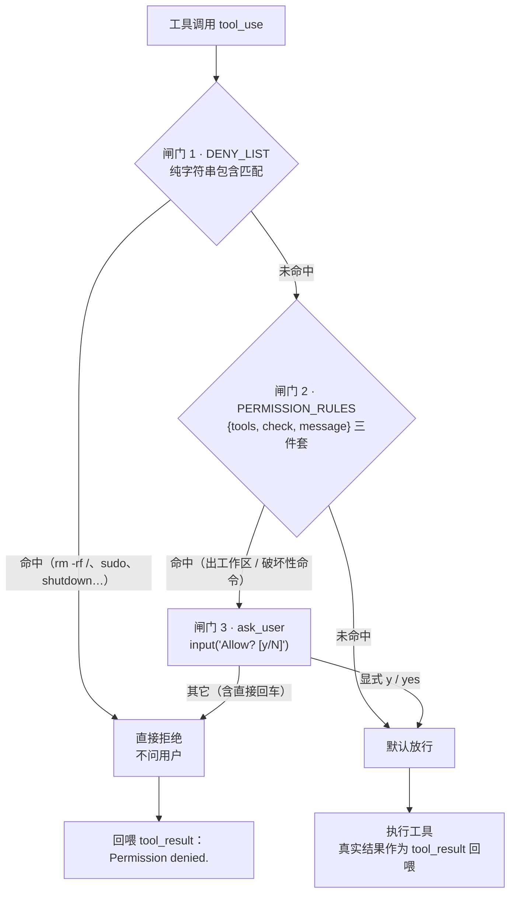
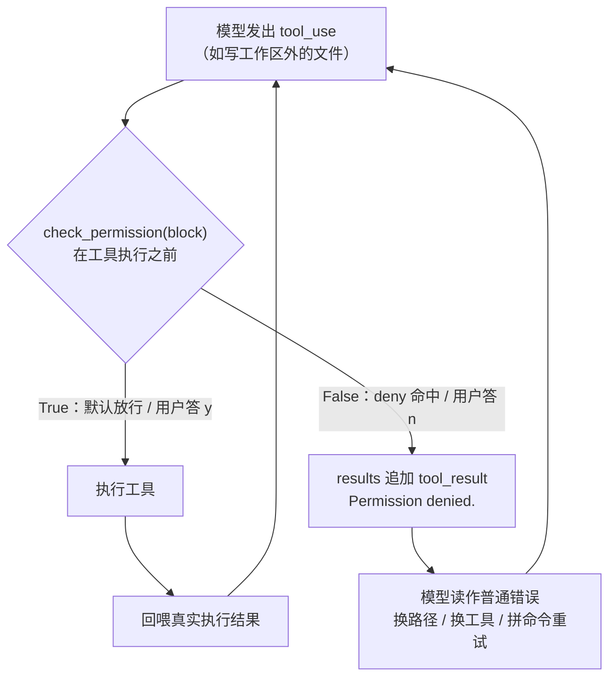

# s03 Permission — 执行前做权限判断

> 📖 《Learn Claude Code》章节笔记｜[← 返回主笔记](../笔记.md)｜状态：✅ 已完成（2026-10-14）

## 一、本章讲了什么（充分展开，讲透为止）

### 1. 本章要解决的问题

s02 给 agent 配了 5 个工具，其中 file tools 被 `safe_path` 关在工作目录里，**但 bash 完全裸奔**——`rm -rf`、写系统目录、`curl | sh` 都畅通无阻。s02 章末作者自己点破了这颗雷：让它"清理一下项目"，它可能执行 `rm -rf /`。本章的回答是一句原则：**安全边界由代码负责，判断发生在工具执行之前**。注意主语是"代码"不是"模型"——不能指望模型自觉不生成危险命令，必须在 harness 侧设卡。

### 2. 核心方案：三道闸门的权限管线

s02 的循环完全保留，唯一变动是在工具执行前插入 `check_permission()`。每个工具调用依次经过三道闸门，对应三种决策：

| 闸门 | 作用 | 命中后 |
|------|------|--------|
| 1. 拒绝列表（deny list） | 永远禁止的操作（`rm -rf /`、`sudo`） | 直接拒绝，不问用户 |
| 2. 规则匹配 | 取决于上下文的操作（file tools 出工作区、bash 含破坏性命令） | 转交闸门 3 |
| 3. 用户审批 | 闸门 2 命中后暂停，等用户确认 | 用户决定 allow/deny |

三道都没命中 → 直接执行，日常操作零打扰。这个"deny 优先、ask 次之、默认放行"的优先级设计，正是真实 Claude Code 权限模型（allow / ask / deny 三态规则）的教学简化版（见拓展资料 1）。

**🖼️ 图 1：权限决策拓扑（这张图怎么看——自上而下走到第一个命中的闸门就结束：deny 永远最先判，ask 只在规则命中后才出现，两道都没命中才是默认放行）**



### 3. 代码走读（code.py，267 行）

- **闸门 1（check_deny_list）**：`DENY_LIST = ["rm -rf /", "sudo", "shutdown", "reboot", "mkfs", "dd if=", "> /dev/sda"]`，纯字符串包含匹配。README 特别声明它"使用简单字符串匹配来说明权限闸门的位置，**不能视为完整的安全边界**"——这是诚实的教学定位（详见问题 1）。
- **闸门 2（check_rules + PERMISSION_RULES）**：规则是 `{tools, check, message}` 三件套，check 是 lambda，可任意扩展。两条内置规则：① read/write/edit 的路径 `resolve()` 后不在 WORKDIR 内 → "Writing outside workspace"（等于把 s02 的 safe_path 硬拒绝降级为"可审批"）；② bash 命中破坏性模式 → "Potentially destructive command"。
- **一个精致的细节——破坏性命令正则**：`(?i)(?:^|[;&|()\n])\s*(?:rm|del)(?=\s|$|[;&|()])`。它匹配的是**命令位置上的 rm/del 单词**：命令开头或 `;`、`&&`、`|`、括号之后的 `rm` 才算数。所以 `rm file` 命中，而 `model`、`delimiter`、`echo del test.txt`（del 在 echo 参数位置，前导是空格而非分隔符）不误伤——README 的 Windows 示例专门演示了这一点。比起 s01 的黑名单裸匹配，这是"匹配语义而非子串"的一小步。
- **闸门 3（ask_user）**：打印原因 + 工具名 + 完整参数，`input("Allow? [y/N]")`，**默认拒绝**（只有显式 y/yes 才放行）——fail-closed 设计。
- **循环侧只有一处改动**：
  ```python
  if not check_permission(block):
      results.append({... "content": "Permission denied."})
      continue
  ```
  注意拒绝不是抛异常，而是回喂一条 `"Permission denied."` 的 tool_result——完全延续 s02"错误文本化"的哲学：**拒绝也是模型的上下文**。
- **SYSTEM prompt 同步修改**：加了 "All destructive operations require user approval."——把权限规则的存在告知模型，让它预期到审批交互。Prompt 与代码机制配套，这也是 harness 设计的一部分。

### 4. 实战观察（沙盒实测，/tmp/lcc-s03）

四个场景全部实测，发现三个文档没写的真实行为：

- **正常路径**：工作区内 `write_file test.txt` 无任何提示直接通过；`rm` 删除触发闸门 2，答 `y` 后执行，模型确认删除完成。✅
- **闸门 1**：要求执行 `sudo ls /root` → 直接 `[blocked] Blocked: 'sudo' is on the deny list`，不问用户，模型收到 "Permission denied." 后放弃。✅
- **闸门 2（file tools）**：`write_file` 写 `../lcc_escape.txt` 触发 "Writing outside workspace"，答 `y` 后真的写出了工作区（/tmp/lcc_escape.txt 确实存在）。✅
- **观察 1（重要）：拒绝 ≠ 终止，模型会把拒绝当错误来"绕过"**。第二次写工作区外答 `n` 后，模型没有停下来问用户，而是连续换了 4 种姿势重试同一目标：改用 bash `ls` 探查 → 拼 `&&` 的 rm → 换相对路径 → `rm -f` → 换绝对路径。**"Permission denied." 被模型理解为可重试的错误，而不是用户的最终意志**——这是 s02 错误自愈本能与安全语义的一次正面冲突。
- **观察 2（健壮性缺口）**：审批走 `input()`，当 stdin 是管道且输入耗尽时抛 `EOFError`，**整个 agent loop 崩溃退出**（Traceback 实测复现）。管道/无人值守场景下闸门 3 反而成了单点故障。
- **观察 3（规则的按工具名匹配有盲区）**：让它写 `/etc/lcc_test.txt`，模型没用 `write_file` 工具而选了 `bash sudo tee ...`——同语义的行为换个工具就换了一套规则（这次是撞进闸门 1 才被拦住）。

**🖼️ 图 2：拒绝回喂后的重试闭环（这张图怎么看——注意 deny 不是抛异常而是变成一条普通 tool_result，模型读到它后沿既有的"错误即重试"本能绕回下一轮，权限拒绝因此被当成待克服的障碍）**



## 二、与前面章节的关系

**递进 + 补雷 + 再次验证循环不变性**。

- **承 s02 的引线**：s02 章末明说 file tools 有 safe_path 而 bash 裸奔，"s03 → 在工具执行之前加一道门"——本章就是兑现。注意本章没有删掉 safe_path，权限管线是叠加在其上的第二道防线（纵深防御的雏形）。
- **验证 s01 的断言**：s01 笔记里我留下的问题 1 是"加权限时循环骨架动不动？"——本章答案：**不动**。`check_permission` 包在"工具执行"这一步的外面，循环只加一行 `if not check_permission(block): continue`，发消息→查 tool_use→执行→回喂的骨架原封未动。s01 问题 1 继续得到验证 ✅（第二个证据）。
- **延续 s02 的哲学**：权限拒绝沿用"错误文本化"——deny 以 tool_result 形式回喂而不是中断循环。但实测（观察 1）暴露了这枚硬币的反面：自愈本能会把用户拒绝也当成要克服的障碍。
- **为 s04 埋引线**：章末作者自问"想在每次工具执行前后加日志？想操作后自动 git commit？这些扩展逻辑散落在 loop 里，循环很快膨胀"——`check_permission` 硬编码在循环里被明确指认为下一个要重构的对象。

## 三、实战场景（怎么用）

1. **给自己的 agent 设计权限层时直接抄三态模型**：deny（永远不行，如生产库、密钥文件）→ ask（看上下文，如删文件、出工作区）→ allow（日常放行）。真实 Claude Code 的 settings.json 就是 `allow`/`ask`/`deny` 三张规则表 + `Bash(npm run test *)` 这样的工具级规则语法，本章是它的 30 行原型。
2. **CI / 无人值守场景的权限设计**：实测发现闸门 3 的 `input()` 在管道下会 EOF 崩溃——自动化环境里"问用户"这条路必须换成白名单兜底或显式失败策略（fail-closed + 记录），不能假装用户存在。
3. **写拒绝信息时写明语义**：实测显示 "Permission denied." 会被模型当可重试错误。生产系统应在拒绝文本里写明 "The user denied this action. Do not retry; ask the user how to proceed."，把"用户意志"和"执行失败"在上下文里区分开。
4. **规则按语义匹配，不要只按命令字符串**：观察 3 显示模型会在 bash 和 file tools 之间"套利"，权限规则应尽量覆盖语义等价的通道（比如所有写操作统一走路径检查）。

## 四、我的思考

*（待补充——你的联想、认同与质疑写在这里）*

## 五、我的问题与解答

- ❓**字符串黑名单（deny list）到底能挡住什么？**
  → ✅解答：几乎只能挡住"模型原样生成教科书式危险命令"的情况。绕过轻而易举：`rm -rf ./` 不含 `"rm -rf /"`、`rm -f` 不在列表、变量间接 `X=/; rm -rf $X`、命令混淆都行。README 自己声明它"不能视为完整的安全边界"——闸门 1 的定位是**教学示意 + 兜住最常见的意外**，不是安全机制。真正的边界需要沙箱/容器/OS 级隔离（这正是 Claude Code 后来加 Bash sandbox 的方向，见拓展资料 1）。**字符串匹配防的是手滑，防不了攻击**。
- ❓**用户拒绝后，模型为什么反复换姿势重试？这是 bug 吗？**
  → ✅解答（实测 + 机制分析）：不是循环的 bug，是**上下文语义的缺失**。模型只看到 "Permission denied." 这四个字，它和 "Error: text not found" 长得一模一样——而 s02 教它的就是"读到错误就换参数重试"。拒绝文本里没有携带"这是用户的最终决定、目标是禁区"这层信息，模型的自愈本能自然启动。解法方向：① 拒绝文本写明不可重试及原因；② 被拒后由 harness 注入"用户拒绝了 X，等待新指令"；③ 交互侧提供"永远拒绝此类操作"升级选项（把 ask 升级为 deny 规则）。**待验证**：s04+ 是否改进了拒绝语义（s04 实测显示未改进，行为原样继承）。
- ❓**审批交互（闸门 3）在管道/自动化环境下崩溃，正确的工程姿势是什么？**
  → ✅解答（实测 EOFError 后的分析）：`input()` 假设了交互式终端。正确姿势是把"审批者"抽象成可替换的回调/策略对象：交互终端用 `input()`，管道环境用"读取预授权白名单"，CI 用"全部拒绝并记录"。这实际上已经指向了 s04 的 hook 化——审批只是 PreToolUse 的一个插件，策略可以按部署环境注入。

## 六、关键摘记

⭐ 安全边界由代码负责，判断发生在工具执行之前｜⭐ 三道闸门 = deny 优先 → ask 次之 → 默认放行（真实 Claude Code allow/ask/deny 的原型）｜⭐ "Permission denied." 也是模型的上下文——但模型会把拒绝当错误重试｜💡 破坏性命令正则匹配"命令位置上的单词"而非子串，`model`/`delimiter` 不误伤｜💡 字符串黑名单防手滑不防攻击，README 自己承认不是安全边界｜💡 审批用 input()，管道耗尽直接 EOFError 崩掉整个 loop

## 七、代码实战

跑通 ✅（沙盒 /tmp/lcc-s03 实测：工作区内写文件直接通过；`rm` 触发闸门 2 审批后执行；`sudo` 被闸门 1 直接拦截；写 `../escape.txt` 触发闸门 2；观察到"拒绝后模型换 4 种姿势重试"和"stdin 耗尽 EOFError 崩溃"两个文档未述行为）　改造实验 ☐（待做：把拒绝文本改成 "The user denied this. Do not retry."，观察模型重试行为是否消失）

## 八、📚 本章拓展资料与对照（一搜，每条详细展开）

**1. Claude Code 官方权限文档（code.claude.com/docs/en/settings，已于 2026-10-14 curl 验证）——赞同：本章的生产版**

它讲了什么：官方文档里 Claude Code 的权限模型就是本章三道闸门的工业化版本：`settings.json` 里 `permissions` 字段分 **allow / ask / deny** 三张规则表（实测抓取到示例：`"allow": ["Bash(npm run lint)", "Bash(npm run test *)"]`，`"deny": ["Read(./.env)", "Read(./.env.*)"]`）；规则语法是"工具名 + 括号内模式"（`Bash(...)`、`Read(...)`、`Edit(...)`），支持通配；规则可持久化在用户级/项目级/团队级/组织级四个层级的 settings 文件里，还有 permission modes（default / acceptEdits / plan / bypassPermissions）和新增的 Bash sandbox 沙箱环境。

与本章的对照：**完全一致的部分**：三态决策（deny/ask/allow）、按工具名+参数模式匹配、deny 优先于 ask——本章每条都能对应上。**差异部分**：① 官方规则是**声明式配置**（JSON 文件、可版本管理、团队共享），本章是代码内硬编码；② 官方有"这次允许 / 永远允许"的选项，用户批准一次后可沉淀为 allow 规则，避免审批疲劳——本章每次都要重问；③ 官方明确承认命令规则不够、另加 OS 级沙箱兜底。我的判断：本章教的是权限模型的**决策拓扑**（三态 + 优先级），官方文档展示的是它的**配置化与持久化**——学完本章再看官方文档，几乎每个概念都有预演。

**2. Simon Willison《The Lethal Trifecta for AI Agents》（2025-06-16，已于 2026-10-14 curl 验证原文）——反方：权限闸门挡不住真正的威胁**

它讲了什么：Simon Willison 提出"致命三要素"：当一个 agent 同时具备 ①**访问私有数据**、②**暴露于不可信内容**（工具结果、网页、邮件里可能藏攻击者写的指令）、③**对外通信能力** 时，攻击者可以通过提示注入诱骗 agent 主动把私有数据送出去。核心论点是：**LLM 会把内容里的指令当指令执行**——危险命令不一定是模型"自己想干坏事"，而是被喂进来的恶意内容诱导的；而人类审批在"这看起来是个合理操作"的社会工程包装面前并不可靠，且审批次数一多必然疲劳、习惯性点 y。

与本章的冲突：本章的隐含威胁模型是"危险来自模型自己的决策"，防御是"危险命令出现时问用户"。Trifecta 指出：当恶意指令藏在 `read_file` 读回的网页/邮件正文里时，模型会真心相信"把这个文件内容 POST 出去"是用户的正当需求——此时闸门 2 弹出的审批框在人类眼里同样合理，**权限管线被绕过不是因为规则弱，而是整条链路上的"意图"都被污染了**。我的辩证判断：这不是说本章没用——闸门是必要的纵深防御层，deny list 挡手滑、审批挡意外，价值真实存在；但本章（和本书这一层）没有触及数据流维度的防御（哪些内容进了上下文、哪些出得去），三要素的防御需要"降低三要素同时在场的机会"这种架构级取舍。读到 s14 MCP（外部工具接入 = 不可信内容大举进入上下文）时应回来重新审视本章的边界。

**3. OWASP LLM Top 10: LLM06:2025 Excessive Agency（genai.owasp.org，已于 2026-10-14 curl 验证）——赞同：行业风险清单的权威背书**

它讲了什么：OWASP 把"过度代理"列为 LLM 应用十大风险第 6 位：LLM 系统被赋予了调用工具/接口行动的自主权，风险来自三个"过度"——**过度的功能**（工具给得太多）、**过度的权限**（工具的权限太大）、**过度的自主**（行动前缺少人类确认）。缓解措施包括：最小权限原则、破坏性操作必须人在回路（human-in-the-loop）、限制工具可调用的范围、记录与审计行动。

与本章的对照：本章三道闸门几乎是这份清单缓解措施的最小实现——deny list = 削减过度功能，工作区规则 = 削减过度权限，闸门 3 = 人在回路削減过度自主。一致性说明本章抓住的是行业共识而非作者私货。差异在深度：OWASP 还强调了本章没有的审计日志（s04 的 log_hook 补上）、以及对"自主性"本身的分级（不是所有操作都配同等的审批强度）。我的判断：用 OWASP 的三"过度"框架可以给任何 agent 的权限设计做体检——逐个工具问：功能必要吗？权限最小吗？自主程度配得上风险吗？
