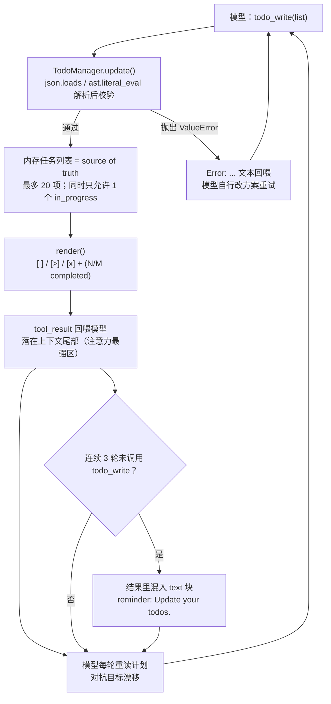
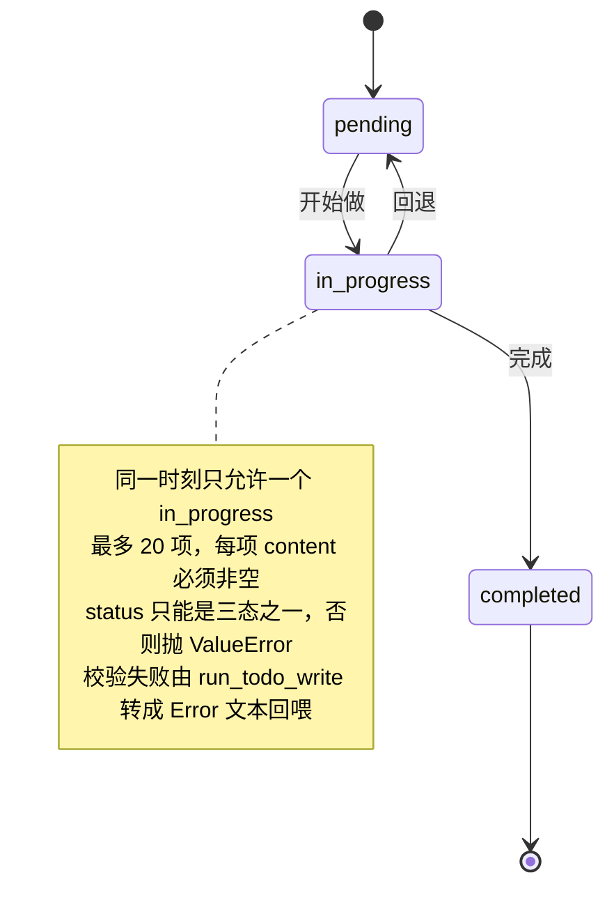

# s05 TodoWrite — 没有计划的 Agent，做着做着就偏了

> 📖 《Learn Claude Code》章节笔记｜[← 返回主笔记](../笔记.md)｜状态：✅ 已完成（2026-10-14）

## 一、本章讲了什么（充分展开，讲透为止）

### 1. 本章要解决的问题

给 agent 一个复杂任务："把所有 Python 文件改成 snake_case 命名，然后跑测试，修好失败。"agent 开干，改 3 个文件、跑测试、发现 2 个失败、开始修——修着修着，它忘了最初是"改成 snake_case"，测试失败把注意力全吸走了。这就是**长任务中的目标漂移**，而且对话越长越严重：工具结果不断填满上下文，system prompt 里那句任务目标的影响力被持续稀释——一个 10 步重构，做完 1-3 步就开始即兴发挥，因为 4-10 步已经被"挤出注意力"了（这个现象的学术名字和证据见拓展资料 2：Lost in the Middle）。

### 2. 核心方案：一个"不干活"的工具 + 一个计数器

s05 保留 s04 的全部机制（工具分发、权限、hooks），加入 `todo_write` 工具和 reminder 计数器。关键洞察是 README 里加粗的那句：**todo_write 不给 agent 增加任何执行能力，它增加的是规划能力**。todo 列表本身一行代码也不执行，实际工作仍由原有 5 个工具完成——它是一个**外置工作记忆**：计划从模型的内部状态（易漂移）被外化为上下文里的持久 artifact（每轮可见、可对照）。

三个组件：

1. **TodoManager**：持有内存中的任务列表，负责校验更新并把渲染结果返回给模型；
2. **todo_write 工具**：走 s02 的 dispatch map 注册，工具定义与其他工具并列；
3. **reminder 计数器**：连续 3 个工具调用轮次没用 `todo_write`，harness 就往第三轮的结果里追加一条 `<reminder>Update your todos.</reminder>`，随后计数清零。

**🖼️ 图 1：todo 外化为上下文 artifact 的闭环（这张图怎么看——注意右侧那条回到模型的闭环：计划不在模型脑子里，而是每轮作为最新 tool_result 重新投递到上下文尾部，reminder 只是这条闭环的兜底保险丝）**



### 3. 代码走读（code.py，368 行）

- **TodoManager.update()——校验是真正的主角**。接受 list 或字符串；字符串先 `json.loads`、失败再 `ast.literal_eval`（**明确不用 `eval`**，模型生成的字符串直接 eval 是远程代码执行的邀请函）。校验规则：最多 20 项；每项必须有非空 `content`；`status` 必须是 `pending/in_progress/completed` 三态之一；**同一时间只能有一个 `in_progress`**——这条约束最妙，它用数据结构强制"串行专注"，把"一次只做一件事"从 prompt 建议变成了硬约束。所有校验失败抛 ValueError，到 `run_todo_write` 被转成 `"Error: ..."` 文本回喂——s02 的错误文本化哲学第三次出现，模型读到 "Only one todo can be in_progress at a time" 会自己改方案重试。
- **render()**：`[ ] pending` / `[>] in_progress` / `[x] completed` + `(N/M completed)` 进度行。渲染结果**既返回给模型（tool_result）也打印到终端**——人也能实时看到 agent 的计划和执行进度，这是可观测性红利。
- **SYSTEM prompt 修改**：加入 "Before starting any multi-step task, use todo_write to plan your steps. Update status as you go."——工具给了能力，prompt 给动机，两者配套。
- **reminder 计数器的精确语义**（值得细读）：
  ```python
  rounds_since_todo = 0 if used_todo else rounds_since_todo + 1
  if rounds_since_todo >= 3:
      results.append({"type": "text", "text": "<reminder>Update your todos.</reminder>"})
      rounds_since_todo = 0
  ```
  ① 按**轮**（LLM turn）计数，不是按工具调用计数——一轮里并行 3 个 write_file 也只 +1；② reminder 是作为 `text` 块**混在 tool_result 数组里**回喂的，终端上不可见，只有模型看得到；③ 触发后立刻清零。这是 harness 主动向上下文注入"软提醒"的第一个例子——不拦截、不改行为，只是提高"该更新计划了"在下一轮注意力里的权重。
- **一个细节**：`rounds_since_todo` 定义在 `agent_loop` 函数开头，所以**每个用户回合重新计数**——reminder 约束的是单次任务内的计划维护，不跨任务。

**🖼️ 图 2：todo 三态与校验约束（这张图怎么看——状态流转本身只有三态，重量全在注释：校验规则把"一次只做一件事"从 prompt 建议变成了数据结构级的硬约束）**



### 4. 实战观察（沙盒实测，/tmp/lcc-s05）

- **任务 1（建 Python 包 + 跑测试）**：模型的第一个工具调用**就是 todo_write**，列出 3 项（首项直接 in_progress）→ 一轮内并行 3 个 write_file 建完文件 → todo 更新为 2/3 → 跑 pytest 时发现系统 Python 3.14 是 PEP 668 externally-managed 装不了 pytest，**模型自行加步骤建 .venv 装 pytest** → 最终 3/3 completed + Stop hook 统计 9 次工具调用。计划不是枷锁：遇到意外时模型修改了执行路径但仍用 todo 保持全局可见。
- **任务 2（逐轮执行 6 个 echo）**：强制一轮一个命令，观察 todo 的逐轮维护——模型**每一轮都 todo_write 一次**（[x] 递增、[>] 前移，1/6 → 6/6），`rounds_since_todo` 从未有机会到 3，reminder 整局未触发。说明：对 Kimi 这个级别的模型，SYSTEM prompt 的"边做边更新"引导依从度极高，reminder 是兜底的保险丝而不是主要驱动力。
- **reminder 机制的独立验证**（单元级，不依赖模型行为）：直接 import 模块测试——双 in_progress → "Only one todo can be in_progress at a time"；21 项 → "Max 20 todos allowed"；非法 status、空 content 全部报错；JSON 字符串和 Python 字面量字符串两种输入都能解析；模拟 3 轮无 todo 后 reminder 如期注入并清零。✅
- **值得记录的机制盲区**：reminder 和 todo 状态都在 harness 侧，但**模型可以"撒谎"**——把没做的事标 completed，harness 无法核实（实测中模型如实更新，但机制上无保障）。todo 是自查表，不是审计链。

## 二、与前面章节的关系

**机制的大汇合点 + 一个意味深长的"例外"**。

- **s02 的 dispatch 第三次兑现**：todo_write 作为第 6 个工具加入 `TOOL_HANDLERS`，"加一个工具只加一行"再次成立，循环的工具分发路径零改动。
- **s03/s04 机制原样运转**：todo_write 的每次调用照样过 PreToolUse 的 permission_hook 和 log_hook（实测日志里 `[HOOK] todo_write([...])` 清晰可见）——新工具自动继承已有的全部横切能力，这正是 s04 hook 化的收益兑现。
- **循环骨架第五次不变**……除了一个例外：**reminder 计数器是 s04 之后第一段又硬编码回循环里的逻辑**。按 s04 自己的哲学，reminder 完全可以做成 hook（比如在结果回喂前触发一个自定义事件）——作者没有这么做，或许是刻意展示"hook 不是银弹：与循环时序深度耦合的状态机（按轮计数、清零）放循环里更直白"。这个"破例"值得记住：架构原则服务表达力，而不是反过来。
- **承上启下**：s04 问"agent 有没有停下来想过先做什么再做什么"，本章回答；章末又指出新问题——任务太大时（"重构整个认证模块"）单层 TODO 不够，一个任务本身是几十个小任务的集合 → s06 Subagent。

## 三、实战场景（怎么用）

1. **给长任务 agent 加"外置自查表"**：凡是超过 5 步的任务，提供 todo_write 式工具 + system prompt 引导 + 闲置提醒三件套——本章实测证明组合有效（模型首调用即规划、逐轮维护、全程未漂移）。
2. **用"单 in_progress"约束治疗多线程漂移**：如果你的 agent 经常同时开几条线然后烂尾，把"同时只能一个进行中"做成数据校验而非 prompt 请求——硬约束比软引导可靠。
3. **TODO 列表当审计界面**：render 结果同步打印到终端的设计值得抄——人不用读模型的 thought 流，扫一眼 `[ ]/[>]/[x]` 就知道 agent 的计划和进度，出错时也容易定位"计划错了还是执行错了"。
4. **reminder 模式推广**：任何"希望模型定期做但不该强制"的行为（如定期总结进度、定期验证假设），都可以用"harness 计数 + 往 tool_result 里塞软提醒"实现，成本低、不阻塞。

## 四、我的思考

*（待补充——你的联想、认同与质疑写在这里）*

## 五、我的问题与解答

- ❓**todo_write 为什么有效？它不就是多了一个"记笔记"的工具吗？**
  → ✅解答（机制拆解 + 学术对照）：有效性来自三层叠加而非工具本身：① **位置效应**——todo 列表每轮作为 tool_result 出现在上下文**尾部**（最新位置），而 Lost in the Middle 研究（拓展资料 2）证明模型对开头和结尾的信息利用最好、中段塌陷；初始任务目标在遥远的开头，todo 却把"当前该做什么"反复刷新到注意力最强的位置；② **状态外化**——计划从"模型此刻在想什么"（不可持久、易漂移）变成"上下文里白纸黑字的 artifact"（每轮重新读入、可对照）；③ **约束硬化**——单 in_progress、三态校验把"串行推进"变成数据保证。所以 todo_write 的本质不是"规划器"，是**对抗上下文衰减的工作记忆装置**。
- ❓**状态存 harness（TodoManager）还是让模型自己维护（比如直接写个 TODO.md 文件）？**
  → ✅解答：两者本章其实都做了对折——TodoManager 是 source of truth（可校验、可计数 reminder），渲染结果回喂模型（模型永远看到最新快照）。相比让模型自己写 TODO.md：manager 方案能保证格式校验和约束（单 in_progress），且 reminder 计数器有可靠的状态可读；代价是状态在内存里、会话结束即失（s09 记忆/s10 任务系统才解决持久化）。真实 Claude Code 的 TodoWrite 也是 harness 侧管理。**判断：约束需要代码保证时放 harness，只是参考信息时放文件**。
- ❓**reminder 为什么按"轮"计数而不是按工具调用计数？为什么阈值是 3？**
  → ✅解答（代码走读 + 推断）：按轮计数是因为"更新计划"的决策发生在轮粒度——模型每轮重新决定下一步干什么，一轮内并行 3 个 write_file 属于同一次计划执行，不该计 3 次"没更新"。阈值 3 是经验值：太小会刷屏提醒（每次 reminder 都占上下文且打断心流），太大则漂移已经发生。**待验证方向**：阈值是否该随 todo 总数自适应（20 项的大计划允许更长的执行间隔）——本书后续章节未见回应，可作为改造实验。
- ❓**模型会不会用 todo_write "表演勤奋"？**（标了一堆 completed 但实际没做）
  → ✅解答（部分待验证）：机制上完全可能——TodoManager 只校验格式不核实事实，标 completed 不需要任何证据。本章实测中模型是诚实的，但这是因为当前模型对工具结果的行为有基本忠实度。缓解方向：harness 可以把"标 completed"和客观证据挂钩（比如该项关联的测试必须通过）；或像 Claude Code 那样让人类扫 todo 列表做抽查。**这正是拓展资料 3（Kambhampati）批评的具体化：LLM 的自我报告不能当验证用**。

## 六、关键摘记

⭐ todo_write 不增加执行能力，增加规划能力——计划从内部状态外化为上下文 artifact｜⭐ 同一时间只能一个 in_progress：用数据约束代替 prompt 请求｜⭐ reminder = harness 向上下文尾部注入软提醒，对抗注意力稀释｜💡 模型生成的字符串参数用 json/ast.literal_eval 解析，永远不 eval｜💡 reminder 按轮计数而非按工具调用；每个用户回合重新计数｜💡 s04 之后 reminder 又硬编码回了循环——hook 不是银弹，与循环时序耦合的状态机放循环里更直白｜💡 TodoManager 校验格式不核实事实：todo 是自查表，不是审计链

## 七、代码实战

跑通 ✅（沙盒 /tmp/lcc-s05 实测：任务 1 首调用即 todo_write 列 3 项、中途遇 PEP 668 自行加步建 venv、3/3 完成；任务 2 逐轮 echo，模型每轮维护 todo，reminder 未触发；单元级验证全部校验规则和 reminder 第 3 轮触发逻辑）　改造实验 ☐（待做：把 reminder 阈值从 3 改成 1，观察提醒密度对模型行为的影响）

## 八、📚 本章拓展资料与对照（一搜，每条详细展开）

**1. Anthropic 官方《Best practices for Claude Code》（anthropic.com/engineering/claude-code-best-practices，现重定向至 code.claude.com 文档站；已于 2026-10-14 curl 验证内容）——赞同：规划优先的官方工作流**

它讲了什么：官方最佳实践把"先探索、再计划、后写码"（Explore first, then plan, then code）列为推荐工作流：直接让 Claude 跳进去写码容易"解决错问题"，用 plan mode（Shift+Tab 或 `--permission-mode plan`）把探索/规划与执行分离——规划阶段 Claude 只读不改，产出计划后再动手。大规模改造场景则建议**先让 Claude 把任务清单写成文件**（如"列出全部 2000 个待迁移文件存到 files.txt"），再用脚本逐项驱动 `claude -p` 循环处理。

与本章的对照：方向完全一致——"动手之前先想清楚"是共同主张；官方甚至把"任务清单外化成文件"用到了比本章更重的场景（跨多个并行会话共享一份清单）。差异在分工：本章的 todo_write 是**模型自查自用**的工作记忆（写在 harness 内存、每轮回喂），官方的清单文件方案多了**人可编辑、脚本可驱动**的维度——计划不仅是模型的拐杖，也是人机协作的接口。我的判断：两者互补——短任务用 todo_write（轻、有 reminder 兜底），跨会话/大规模任务用清单文件（持久、可审计、可断点续跑）。

**2. Lost in the Middle（Liu et al., arXiv:2307.03172，已于 2026-10-14 curl 验证摘要）——学术支撑：本章的问题陈述有实验证据**

它讲了什么：这篇 2023 年的论文系统测量了语言模型对长上下文的利用能力：在多文档问答和键值检索任务上，**相关信息的位置显著影响性能**——信息在上下文开头或结尾时性能最好，**必须访问中段信息时性能显著下降**，即使是专门为长上下文设计的模型也一样。结论：模型并不能稳健地利用长输入上下文。

与本章的对照：本章问题陈述里"对话越长，system prompt 的影响力被稀释""4-10 步被挤出注意力"正是 lost-in-the-middle 现象在 agent 场景的具体形态：任务目标在上下文开头（还行），但最初的计划细节和中间步骤很快滑入"中段坟场"。todo_write + reminder 的组合则是对这个现象的**工程级对症**：todo 列表每轮作为最新 tool_result 出现在上下文**尾部**（注意力最强区），等于每轮都把"当前该做什么"重新投递到黄金位置。我的判断：这一对照让本章从"经验技巧"升级为"有认知科学依据的设计"——reminder 的本质不是催促，是**位置工程**：周期性地把计划重新写回上下文的强注意力区。

**3. Kambhampati et al.《LLMs Can't Plan, But Can Help Planning in LLM-Modulo Frameworks》（arXiv:2402.01817，已于 2026-10-14 curl 验证摘要）——反方：LLM 列的计划不是"规划"**

它讲了什么：这篇立场论文（AI 规划领域权威 Subbarao Kambhampati 团队）针对"LLM 能规划"的乐观叙事泼冷水：自回归 LLM **自身不能做真正的规划和自我验证**——它们生成的"计划"是从训练数据里联想出的近似知识，不保证正确性、完备性、可执行性；文献中的乐观结论多来自把规划问题简化或混入人工干预。作者的正面主张是 **LLM-Modulo 架构**：LLM 当"通用近似知识源"负责提想法、生成候选计划，**正确性保证交给外部符号规划器/验证器**，迭代修正。

与本章的冲突：按这篇论文的严格定义，本章的 todo_write **根本不是"规划能力"**——README 说"它增加的是规划能力"，论文会说那只是一份不保证对的待办清单；模型随手就能漏步骤、标错状态（本章实测也佐证：遇 PEP 668 时计划是临时改的，且"标 completed"无任何核实）。我的辩证判断：两边说的"规划"不是同一个东西——论文关心的是**计划的可证明正确性**（关键任务、安全攸关场景），本章关心的是**长任务中的自我组织与可观察性**（日常编码 agent 场景）。todo_write 的价值确实不在"计划质量"，而在"状态外化"带来的三个可工程化的好处：可提醒（reminder）、可对照（每轮可见）、可审计（人可扫一眼）。但论文的警告依然有效且具体到本章：**不要把 todo 列表当事实来源**——模型说 3/3 completed 不等于三件事都做对了，正确性验证必须走工具证据（测试结果、文件内容），这正是 s17 目标回路"以证据论成败"方向要解决的事。读到 s17 时回来验证。
