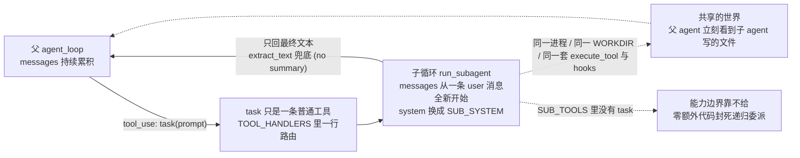
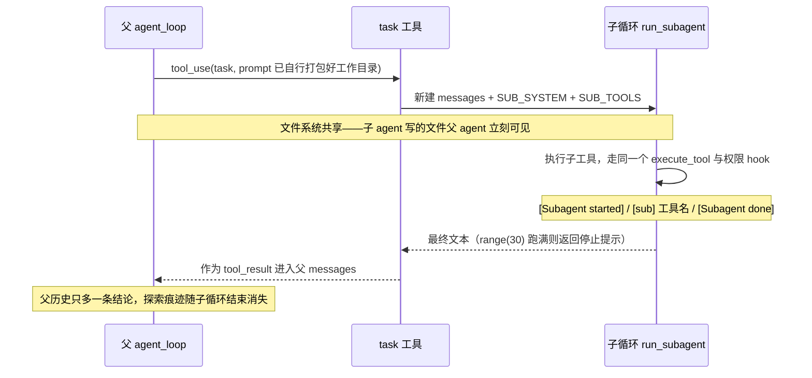

# s06 Subagent — 给子任务一段独立上下文

> 📖 《Learn Claude Code》章节笔记｜[← 返回主笔记](../笔记.md)｜状态：✅ 已完成（2026-10-14）

## 一、本章讲了什么（充分展开，讲透为止）

### 1. 本章要解决的问题

Agent 修 bug 时为了追踪调用链会读很多文件，每次工具调用和结果都留在父循环的 `messages[]` 里。调用链弄清之后，这些中间细节大多不再有用，却仍然占据上下文——这是 s01 就埋下的"历史无限膨胀"之雷在"探索型子任务"场景下的集中爆发。问题的本质是：**探索过程的信息量远大于探索结论**，而两者在单一消息列表里被迫同寿。

### 2. 核心方案：嵌套循环 + 上下文隔离

方案一句话：把"子任务"做成一个工具 `task`，调用它时**同步启动一个全新的 agent loop**——新消息列表、新 system prompt（`SUB_SYSTEM`）、只有基础工具。子循环跑完后，**只有最终文本**作为 `tool_result` 回到父上下文，中间的所有探索痕迹随子循环结束而消失。

README 用一张边界表把设计决策钉死，每一条都值得展开：

| 决策 | 选择 | 原因 |
|------|------|------|
| 对话 | 全新的 `messages[]` | 不把父对话复制给子 Agent |
| 执行 | 同一进程和 `WORKDIR` | 两个循环都能看到文件系统修改 |
| 返回值 | 只返回最终文本 | 子 Agent 的工具调用和结果不进入父消息列表 |
| 委派深度 | `SUB_TOOLS` 中没有 `task` | 本章只允许一层委派 |
| 工具策略 | 共享 Hooks | 父子循环使用相同的权限检查 |

注意这个设计的精确性：**隔离的是消息，不是进程或文件系统**。子 agent 写的文件父 agent 立刻可见（反之亦然），这使得"子 agent 干活、父 agent 验证"成为自然的工作流。而"子 agent 没有 task 工具"这一行 `SUB_TOOLS = list(BASE_TOOLS)`，用零行额外代码就封死了递归委派——**能力边界的最佳实现方式往往是"不给"而不是"拦截"**。

**🖼️ 图 1：父子 agent 的上下文隔离与机制共享（这张图怎么看——实线是"委派出去、只回结论"的消息通道，虚线是"消息之外全都共享"的世界）**

### 3. 代码走读（code.py，383 行）

- **`run_subagent(prompt)`**（276–313 行）：本章核心，但它的循环体和父循环**逐字同构**——`client.messages.create` → 过滤 tool_use → 没有 tool_use 就返回 → 有就执行并回喂。作者没有抽象出公共函数，而是把循环写了第二遍，这在教学上是刻意的：让你亲眼看到"子 agent 没有新机制，它就是同一个循环再跑一遍"。差异只有四处：`messages` 从 `[{"role": "user", "content": prompt}]` 全新开始；system 用 `SUB_SYSTEM`（多了一句 "Complete the given task, then return a concise final answer"——明确要求子 agent 收敛出结论）；工具表没有 `task`；多了 `range(30)` 的轮数上限（父循环是 `while True`，子循环有 30 轮保险丝，跑满返回 "Subagent stopped after 30 turns without a final answer"）。
- **`TASK_TOOL` 注册**（316–327 行）：`task` 就是一条普通的工具定义 + `TOOL_HANDLERS` 里一行 `"task": run_subagent`。从父循环视角看，调用子 agent 和读文件**没有任何区别**——这正是 s02 dispatch map 架构红利的体现。
- **可观测性**（277、298、304 行）：`[Subagent started]` / `[Subagent done]` 紫色标记 + 子 agent 每次工具调用打印 `[sub] 工具名: 输出前100字符`。没有这三行 print，子 agent 就是个黑盒；有了它，委派过程在终端里是透明的。
- **返回值兜底**（299 行）：`extract_text(response.content) or "(no summary)"`——子 agent 最后一轮如果只输出 tool_use 之外的空文本，父 agent 至少拿到一个占位符，不会拿到 None。
- **权限传导**：子 agent 的工具调用走同一个 `execute_tool` → 同一组 PreToolUse hooks → 同一个 `permission_hook`。子 agent 想跑危险命令一样会被拦下问 `[y/N]`——**安全策略不随委派稀释**，这是"harness 层共享"最实际的意义。

**🖼️ 图 2：一次委派的完整时序（这张图怎么看——纵向是时间，注意父上下文只在最后一步多出一条结论，中间全部发生在另一段消息列表里）**

### 4. 本章故意缺了什么

子 agent 是**同步阻塞**的：父循环在 `task` 工具返回前完全停住，不能并行委派多个子 agent（→ s13 Agent Teams）；子 agent 失败后父 agent 只能拿到一段错误文本，没有重试/超时之外的治理；子 agent 无法把自己的中间发现"流式"汇报给父 agent，只有一次性最终文本。这些缺失都是后面章节的引线。

### 5. 实战观察（沙盒实测）

在 `/tmp/lcc-s06` 空目录中给出任务："Use a task subagent to create a file notes.txt containing three short lines about subagents, then verify the file exists from the parent agent and tell me its contents." 观察到四个教科书级的行为：

1. **父 agent 立即选择委派**：第一轮就调 `task`，且**自动把上下文打包进 prompt**——hook 日志显示它传的 prompt 是 "You are working in /private/tmp/lcc-s06. Create a file nam..."，主动把子 agent 看不见的工作目录写进了任务描述。这实证了本章的隐含契约：**prompt 是父子之间唯一的信息通道**，父 agent 必须自己判断"子 agent 需要知道什么"。
2. **子 agent 一轮搞定**：`[Subagent started]` → `[sub] write_file: Wrote 201 bytes...` → Stop hook 报告 "session used 1 tool calls" → `[Subagent done]`。注意 Stop hook 在子循环里独立计数（1 次），回到父循环后又报了一次（2 次）——两个循环共享 hooks 但各有独立的消息列表，计数口径不同，恰好实证了"共享机制、隔离上下文"。
3. **父 agent 亲自验证**：拿回子 agent 的总结后，父 agent 没有照单全收，而是自己跑 `ls -l notes.txt && cat notes.txt` 复核——共享文件系统让"委派-验证"闭环成立，模型也自发选择了这个模式。
4. **上下文账本的对比**：父上下文中这次探索的全部成本 = 一次 task 调用 + 一段最终文本；如果不用 subagent，写文件请求和 201 字节内容都要留在父历史里。探索越重，隔离的收益越大。

## 二、与前面章节的关系

**递进 + 多次验证前章断言**。结构上是 s01 循环的第一个"嵌套实例"：s01 说"循环骨架不变，机制长在循环上"——本章连"子 agent"这种听起来需要新架构的东西，最后都落成"同一个循环换个消息列表再跑一遍 + dispatch map 里加一行"，循环本体一行没改。这是对 s01/s02 架构论断最有力的一次验证。对 s03/s04 的关系是"继承"：权限和 hooks 不需要为子 agent 重写，因为工具执行入口（`execute_tool`）是共享的——横切机制设计得好，新维度（委派）自动被覆盖。对 s05（TodoWrite）是"互补"：todo 在**同一上下文内**做计划，subagent 把子任务**放逐到另一段上下文**——一个管"别忘了做"，一个管"别记住过程"。承上启下的位置也很清楚：s06 解决"子任务过程污染上下文"，s07 接着解决"知识塞爆 system prompt"，s08 解决"连结论也装不下"——三章合起来是完整的"上下文保卫战"三部曲。

## 三、实战场景

1. **代码库探索委派**：让 agent 排查陌生项目时，明确要求它"用子任务去摸清 X 模块的调用链，只汇报结论"——父上下文只保留结论，不被几十次文件读取淹没。这正是 Claude Code 里 Explore agent 的工作方式。
2. **可丢弃的试错**：让子 agent 尝试一种不确定的修改方案（改文件、跑测试），失败了就丢弃它的全部过程，父 agent 只拿到"方案 A 不work，报错是 Y"——探索成本被压缩成一句话。
3. **写 prompt 时的纪律**：给 subagent 下任务时自查"它看不到我的历史，需要哪些背景？"——本章实测里模型自发打包了工作目录，但生产 harness 里这是提示词设计的责任。

## 四、我的思考

*（待补充——你的联想、认同与质疑写在这里）*

## 五、我的问题与解答

- ❓**为什么隔离的是消息而不是进程/文件系统？进程隔离不是更干净吗？**
  → ✅解答：因为文件系统恰恰是父子协作的通道——本章实测里"子 agent 写文件、父 agent 验证"依赖共享 WORKDIR。进程隔离会切断这个通道，还引入序列化、同步、环境复制等一堆工程问题。本章要隔离的只是"会膨胀的消息历史"，不是"工作状态"。精准隔离最小必要的东西，是这个设计最聪明的地方：上下文是私有的，世界是共享的。
- ❓**子 agent 为什么不能再委派（SUB_TOOLS 没有 task）？这是技术限制还是设计选择？**
  → ✅解答：纯粹的设计选择（加一行就有），但理由充分：① 委派每深一层，"最终文本回传"的信息损失就叠加一次，祖父 agent 拿到的可能是"摘要的摘要"；② 调试和成本归因变难（一层委派的可观测性已经需要 `[Subagent started]` 这样的显式标记）；③ 递归委派需要防环。真正需要多层编排时应该走显式的多 agent 架构（s13），而不是让 task 工具隐式递归。
- ❓**父 agent 怎么知道什么时候该委派？**
  → ✅解答（部分待验证）：本章靠两处提示：system prompt 里一句 "Use task for focused exploration or a self-contained subtask"，加上 task 工具的 description。实测中模型在"create then verify"任务里主动选择了委派，说明当代模型对"自包含子任务"的识别已经不错。但"委派 vs 自己做"的权衡（委派有启动成本和回传损失）没有硬规则——生产实践里常见做法是显式约定"只读探索类任务一律委派"。

## 六、关键摘记

⭐ 子 agent = 全新 `messages[]` + 同一套工具与 hooks + 只回传最终文本｜⭐ 隔离的是消息，不是进程或文件系统——上下文私有，世界共享｜⭐ 封死递归委派的最佳实现是"不给 task 工具"而不是"拦截"｜💡 prompt 是父子之间唯一的信息通道，父 agent 必须自己打包上下文｜💡 子 agent 的循环和父循环逐字同构——委派没有新机制，只是循环的嵌套实例

## 七、代码实战

跑通 ✅（沙盒 `/tmp/lcc-s06` 实测：父 agent 调 `task` 并自动在 prompt 中打包工作目录 → 子 agent 一次 `write_file` 创建 notes.txt（201 字节）→ Stop hook 对子循环独立计数 → 父 agent 用 `ls + cat` 亲自验证文件内容后汇报；`[Subagent started]/[sub]/[Subagent done]` 标记全部如期出现）　改造实验 ☐（待做：给子 agent 派一个必然超限的探索任务，观察 30 轮保险丝触发后的返回文本）

## 八、📚 本章拓展资料与对照（一搜，每条详细展开）

**1. Anthropic《How we built our multi-agent research system》（2025-06-13）——赞同 + 官方生产级数据**

它讲了什么：Anthropic 复盘其 Research 功能的多 agent 架构：一个 lead agent 规划研究流程，动态创建多个并行子 agent 分头搜索。文中给了 subagent 价值的最精确定义："The essence of search is compression"——子 agent 在**各自的上下文窗口**里消化海量材料，只把浓缩后的结论交还 lead agent，这与本章"中间对话不进父上下文"是同一件事的生产级表述。效果数据：多 agent 系统（Opus 4 lead + Sonnet 4 subagents）在内部研究评测上比单 agent Opus 4 高出 90.2%。**但文中同样给了成本警告**：agent 消耗的 token 约为聊天交互的 4 倍，多 agent 系统约为 15 倍——"多 agent 只在任务价值足够高时才具有经济可行性"。

与本章的对照：本章的 `task` 工具就是文中 orchestrator-worker 模式的最小同步版（本章一次一个、阻塞等待；生产版并行多个）。一致之处：上下文隔离 = 压缩机制。差异与我的判断：本章默认"该委派"，Anthropic 的数据提醒"委派有 15x 量级的 token 成本"——**子 agent 省下的是父上下文，花掉的是真金白银的子上下文**。s06 教机制，这篇博客教经济学，两者合起来才是完整图景。（已于 2026-10-14 用 curl 查证原文及上述数据）

**2. Cognition《Don't Build Multi-Agents》（Walden Yan，2025-06-12）——反方，必须正面回答**

它讲了什么：Devin 团队的核心主张：多 agent 架构（点名 OpenAI Swarm、Microsoft AutoGen）在生产中是错误方向。根本原因是**上下文断裂**：子 agent 只拿到任务描述，看不到父 agent 做出该决定时的完整推理，"action 携带隐含的决策前提"，各 agent 基于残缺上下文做出的局部合理决策拼起来会全局矛盾。作者给出两条 context engineering 原则：**Share context**（共享完整 agent 轨迹，而非片段消息）和 **Actions carry implicit decisions**（行动隐含决策，冲突的行动 = 冲突的隐含决策）。

与本章的冲突与辩证：本章的 `task` 恰恰只传一段 prompt、不回传过程——按 Cognition 的标准这是反模式。我的判断：**双方说的不是同一种"多 agent"**。Cognition 批判的是多个对等 agent 分工推进**同一个紧耦合任务**（比如一个写前端一个写后端，决策互相依赖）；本章的 subagent 是"委派-汇报"模型，适用于**自包含、弱耦合**的子任务（探索、查证、试错），父子之间本来就不需要共享推理过程，只需要共享结论。README 的边界表（只允许一层委派、子 agent 无 task）正是把使用场景**强行约束**在 Cognition 批评不成立的范围里。教训是通用的：一旦子任务与主线决策强耦合（需要知道"为什么这么做"），就该停止委派、回到共享上下文——这正是 s08 压缩而非隔离的适用区。（已于 2026-10-14 用 curl 查证原文）

**辩证总结**：子 agent 是把"上下文压缩"做成架构的手段——用隔离换聚焦，用一段文本的带宽换整段探索的容量。Anthropic 给了它效果背书和成本警告，Cognition 给了它边界条件。本章那一行 `SUB_TOOLS = list(BASE_TOOLS)` 的克制，恰恰是三方共识的交点。
