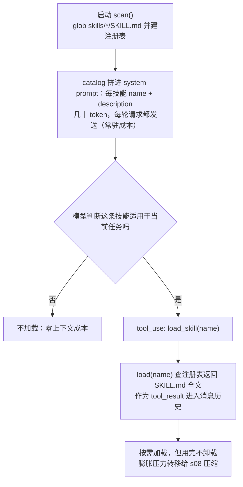
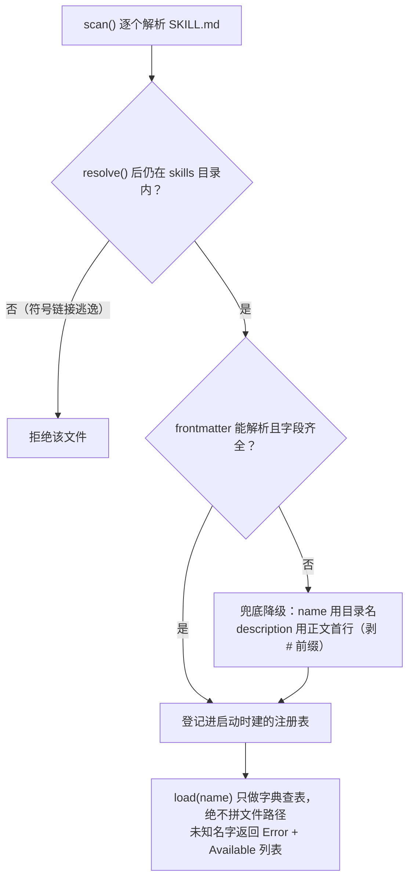

# s07 Skill Loading — 用到时再加载

> 📖 《Learn Claude Code》章节笔记｜[← 返回主笔记](../笔记.md)｜状态：✅ 已完成（2026-10-14）

## 一、本章讲了什么（充分展开，讲透为止）

### 1. 本章要解决的问题

假设项目里有 React 组件规范、SQL 风格指南、API 设计文档三份"做事规矩"，最直接的做法是全部拼进 system prompt。问题是：**system prompt 是每轮请求都全量发送的**，改一个 React 组件时，SQL 指南和 API 文档全程陪跑，白白占用输入 token 和上下文窗口，还稀释模型对真正相关指令的注意力。知识越多，常驻成本越高——这是"知识的工具膨胀问题"（s02 结尾那个"工具不是越多越好"的辩证，在 prompt 侧的翻版）。

### 2. 核心方案：目录常驻，全文按需（Progressive Disclosure）

方案把每份知识切成两层，分别走两条通道进入模型：

| 内容 | 进入模型的位置 | 何时加入 | 成本特征 |
|------|----------------|----------|----------|
| 技能名称 + 一句话描述（目录） | system prompt | 启动时一次 | 每个技能几十 token，常驻 |
| 完整 `SKILL.md` 正文 | `tool_result` | 模型调 `load_skill` 时 | 只有用到才付 |

关键洞察：**"知道有这个技能"和"知道怎么执行这个技能"是两种粒度的知识，成本结构完全不同**。目录让模型具备"何时需要"的判断力，全文让模型具备"如何执行"的规程——前者必须常备，后者理应现用现取。这就是 Anthropic 官方所说的 progressive disclosure（渐进式披露）的最小实现。

**🖼️ 图 1：渐进式披露的两级加载流程（这张图怎么看——上一级是每轮都发送的目录，只有"适用"那条分支才会把 SKILL.md 全文拉进上下文）**

### 3. 代码走读（code.py，399 行）

- **`SkillLoader.scan()`**（89–113 行）：启动时 glob `skills/*/SKILL.md`，逐文件解析。几个防御性细节值得注意：① `manifest.resolve().is_relative_to(skills_root)`——拒绝符号链接逃逸出 skills 目录的文件；② frontmatter 解析失败、不是 dict、缺字段都有兜底——`name` 缺省回退到目录名，`description` 缺省回退到正文第一行（还顺手剥掉 `#` 标题前缀、压缩空白）。**技能写得再烂，目录也不会崩**。
- **`parse_frontmatter()`**（66–87 行）：手写"找第一行 `---`、找下一个 `---`、中间喂给 `yaml.safe_load`"。YAML 解析异常时返回空 metadata 而非抛错——和 s02 的"错误文本化"哲学一致：坏技能降级为无元数据，而不是炸掉启动。
- **`catalog()`**（115–121 行）：只输出 `- name: description` 列表。这份文本被 `build_system_prompt()` 拼进 system prompt，附一句 "Use load_skill to read the full instructions when a skill applies"——**这句提示是整个机制的点火器**，没有它模型不知道目录是可以"点开"的。
- **`load(name)`**（123–128 行）：查启动时建立的注册表返回全文。**`name` 只是字典键，绝不拼成文件路径**——模型无法通过构造名字（如 `../../etc/passwd`）读到 skills 目录之外的文件，注入面在 harness 侧被结构性地封死。叫错名字时返回 `Error: Unknown skill 'X'. Available: ...`——又一次"错误返回值里教模型下一步"。
- **`load_skill` 的注册**（209–231 行）：就是 TOOLS 数组里加一条 schema + `TOOL_HANDLERS` 里加一行 `"load_skill": SKILL_LOADER.load`。**从循环的视角看，加载一份规范和读一个文件是同构的**——知识加载被统一进了 s02 的工具分发框架，零新机制。
- **一个隐藏成本**：加载后的 `SKILL.md` 全文作为 `tool_result` 追加进消息列表，**之后每一轮都在上下文里**。技能是"按需加载"，但不是"用完即弃"——这直接通向 s08 的压缩问题（作者也在"接下来"里点破）。

**🖼️ 图 2：技能加载路径上的两道防御（这张图怎么看——左边两个菱形是 scan 阶段的"坏技能降级"，最下面一行是 load 阶段"只查表不拼路径"的结构性封死）**

### 4. 实战观察（沙盒实测）

在 `/tmp/lcc-s07`（skills 目录软链自课程仓库的 4 个技能：agent-builder / code-review / mcp-builder / pdf）中提问："What skills are available? Then load the code-review skill and tell me the 3 most important rules from it." 观察到三个要点：

1. **第一问零工具调用**：模型直接列出全部 4 个技能及描述——证明目录确实在 system prompt 里，"知道有哪些技能"不需要任何运行时开销。
2. **第二问精确一次调用**：hook 日志显示唯一的工具调用是 `load_skill(['code-review'])`——没有加载其他三个不相关技能，按需性成立。
3. **加载后即遵循**：模型基于返回的 SKILL.md 全文总结出 code-review 技能的规程（安全优先、验证正确性不止看风格、反馈要具体可执行），说明加载进上下文的知识立刻转化为行为约束。

顺带一个环境细节：`SKILLS_DIR = WORKDIR / "skills"` 意味着**从哪个目录启动，就用哪个目录的技能**——技能是工作区级的，这本身就是 Claude Code 项目级 `.claude/skills/` 约定的雏形；沙盒里用符号链接也能正常工作（scan 的 `is_relative_to` 校验对 resolve 后的真实路径判断，软链不会被误杀）。

## 二、与前面章节的关系

**递进 + 回收伏笔**。机制上，本章没有引入任何新的循环逻辑——`load_skill` 只是 dispatch map 里的第六个 handler，再次验证 s02"加能力只加一行"的架构断言。主题上它回收的是 s02 结尾自己埋的辩证：工具/知识"能不能加"（机制成本为零）和"该不该加"（认知与上下文成本不为零）是两个问题——**技能加载就是"该不该加"问题的工程答案：全都注册，按需付费**。它和 s06 构成上下文保卫战的两个侧面：s06 把"过程"隔离出主上下文，s07 把"知识"延迟到需要时才放进上下文——一个是空间换时间，一个是时间换空间。system prompt 的形态也第一次从常量变成 `build_system_prompt()` 函数——harness 开始"动态组装"模型所见的世界，这是后续章节（记忆注入、任务系统）的共同手法。启下：加载进上下文的技能全文同样会膨胀历史 → s08。

## 三、实战场景

1. **团队规范落地**：把 Code Review 清单、提交信息规范、发布流程各写成一个 SKILL.md 放进项目 `.claude/skills/`，描述写清"何时适用"——新人（和 agent）都只在需要时加载对应规程，而不是背下整个 wiki。
2. **给自己的 agent 设计知识层**：凡是"不是每个任务都需要"的指令，一律从 system prompt 降级为技能；system prompt 只留身份、环境和目录。检查标准：如果一段指令在 80% 的任务里用不上，它就不该常驻。
3. **写技能描述当 prompt 工程做**：`description` 是模型决定"要不要加载"的唯一依据（实测里模型纯靠目录判断），要写清"什么任务该用我"，而不是写"我是什么"。

## 四、我的思考

*（待补充——你的联想、认同与质疑写在这里）*

## 五、我的问题与解答

- ❓**技能和直接 `read_file("docs/react-style.md")` 读一份文档，本质区别是什么？**
  → ✅解答：机制上确实同构（都是文本进 tool_result），差别在**发现机制和成本结构**：① 裸文档方案里模型要先知道文档存在、在哪、什么时候该读——这要么靠 system prompt 逐字教（回到本章要解决的问题），要么靠模型猜；技能方案用几十 token 的目录把"存在性 + 适用条件"常驻化。② 技能有结构契约（name/description 的 frontmatter），让 harness 可以做扫描、校验、权限控制（官方实现里技能还能声明 allowed-tools）。一句话：**技能 = 文档 + 目录 + 约定**，价值全在后两者。
- ❓**加载后的 SKILL.md 会一直留在上下文里吗？会不会加载几个技能后又满了？**
  → ✅解答：会留在消息列表里直到被压缩。本章没有"卸载"机制——这正是编排上的刻意安排：技能的典型使用是"做某类任务前加载一次，之后整个任务都需要它"，短暂驻留是特性不是 bug。但确实构成了压力传递：技能解决 system prompt 的常驻膨胀，却把膨胀转移给消息历史，最终由 s08 的压缩管线兜底。三章连起来才是一个自洽的系统。
- ❓**模型会不会忘记加载技能，直接用通用知识蛮干？**
  → ✅解答（部分待验证）：取决于 description 写得是否"可触发"。实测中因为用户显式点名，模型必加载；更难的场景是用户没点名时模型能否从目录联想到。官方文档的建议是把 description 写成"何时用"的触发条件。这本质是个召回率问题，生产上需要用评测集度量——**待验证方向**：构造不显式点名的任务，观察模型自发加载率。

## 六、关键摘记

⭐ 目录常驻 system prompt，全文按需进 tool_result——progressive disclosure 的最小实现｜⭐ 加载技能 = 一个普通工具调用，知识加载复用 s02 的 dispatch map，零新机制｜⭐ 技能的 description 是模型决定"要不要加载"的唯一依据，当 prompt 工程写｜💡 `load()` 只查注册表不拼路径——注入面被结构封死，不靠运行时拦截｜💡 技能"按需加载"但"用完不卸载"，膨胀压力转移给 s08

## 七、代码实战

跑通 ✅（沙盒 `/tmp/lcc-s07`，skills 软链自课程仓库：第一问"有哪些技能"零工具调用直接回答（目录在 system prompt）；第二问精确一次 `load_skill('code-review')` 后基于全文总结规程；未加载任何无关技能）　改造实验 ☐（待做：不显式点名技能，给一个"帮我 review 这段代码"的任务，观察模型是否自发加载 code-review）

## 八、📚 本章拓展资料与对照（一搜，每条详细展开）

**1. Anthropic《Equipping agents for the real world with Agent Skills》（2025-10-16）——官方源头，机制完全对应**

它讲了什么：Agent Skills 的官方设计文档。核心概念与本章逐一对应：技能 = 含 `SKILL.md` 的目录；启动时把每个技能的 name 和 description 预加载进 system prompt——文中明确称之为 **progressive disclosure 的第一级**；模型判断相关后再读全文（第二级）；复杂技能还可以在目录里放更多文件、由 SKILL.md 引用，模型按需逐层深入（第三级及以后）。文中给了一个好比喻：构建技能"就像为新员工准备入职指南"——把组织的过程性知识（procedural knowledge）打包成可组合的资源，把通用 agent 变成专业 agent。该标准已于 2025-12-18 作为开放标准发布，支持跨平台移植。

与本章的对照：本章代码就是这套设计的最小可行实现——两层披露都在，第三层（技能内引用其他文件）留给了读者（SKILL.md 里写"详见某文件"，模型自然会用 read_file 去读，因为技能和工作区共享文件系统）。教学版与官方版的一个实质差异：官方技能可以携带可执行脚本，模型按需运行脚本而不是把脚本读进上下文——"代码不进上下文也能被使用"，这是披露层级的进一步延伸。（已于 2026-10-14 用 curl 查证原文）

**2. Simon Willison《Claude Skills are awesome, maybe a bigger deal than MCP》（2025-10-16）——赞同，并正面收录反方质疑**

它讲了什么：资深工具作者 Simon Willison 的上手评测。亮点观点：① 技能"概念上极其简单"——一个 Markdown 文件加少量 YAML 元数据，每个技能常驻成本只有几十 token；② 他实测了官方 slack-gif-creator 技能，技能包里带校验脚本，模型生成 GIF 后自查大小不合格就重试——技能把"领域 know-how + 工具"一起封装了；③ 一个诚实的限制：**技能完全依赖代码执行环境**（文件系统 + 命令执行），不是任何聊天界面都能用。

文中收录的反方与本章的对照：Willison 明确写道，他看到过对技能的质疑——"简单到几乎算不上一个特性"：往目录里丢 Markdown、让 agent 干活前读一下，这个玩法大家早就会，AGENTS.md 里写一句"创建 PDF 前先读 PDF.md"不就行了？他的反驳："**简单正是重点**（The simplicity is the point）"——对比 MCP 那套包含 hosts/clients/servers/三种传输协议的完整规范，技能把困难的部分外包给 LLM harness 和计算机环境，"扔点文本进去，让模型自己搞定"，反而更贴合 LLM 的精神。我的判断：质疑者对"机制新颖性"是对的（本章代码确实只有 70 行新代码），Willison 对"工程价值"是对的——**目录 + 约定 + 生态可移植性**就是相对于裸 AGENTS.md 的增量，正如 s02 的专用工具之于裸 bash：机制上"没必要"，工程上"很必要"。（已于 2026-10-14 用 curl 查证原文）

**3. Claude Code 官方文档《Skills》（code.claude.com/docs/en/skills）——批判性补充：技能是攻击面**

它讲了什么：官方文档在使用说明之外给出了必须认真对待的安全面向：技能可以声明 `allowed-tools` 字段**为自己授予宽泛的工具权限**（例如声明后调用 git 命令不再需要逐次批准），且该字段在项目技能上即使工作区未经 trust 也会生效——文档原话提醒："A skill can grant itself broad tool access, so review the allowed-tools of skills checked into a repository before you run Claude Code there"，并提供了用权限规则禁用/放行特定技能（`Skill(commit)`、`Skill(deploy *)`）的治理手段。

与本章的对照：本章的教学版 `load_skill` 只返回文本，没有 allowed-tools 提权通道，所以风险只剩一层——**SKILL.md 本身就是注入向量**：它是指令性文本，加载后进入上下文即被模型当作规程遵循。从不可信来源（别人仓库里的 `.claude/skills/`）加载技能，约等于执行别人写的 prompt。官方实现把风险扩大到了权限层。我的判断：技能的"低门槛"（写个 Markdown 就行）和"高权限"（指导 agent 行为甚至提权）之间存在天然张力，采纳任何第三方技能前的 code review 不是可选项——这也呼应了 s03 的主题：**能力越强，权限治理越要前置**。（已于 2026-10-14 用 curl 查证原文）

**辩证总结**：技能机制的技术含量几乎为零，工程价值却很高——它把"知识管理"从 system prompt 的粗暴常驻变成了带目录、带触发条件、带权限治理的分层系统。反方质疑（"不就是读 Markdown 吗"）反而帮我们看清：这个领域的进步常常不是新机制，而是**旧机制加上正确的约定**。
