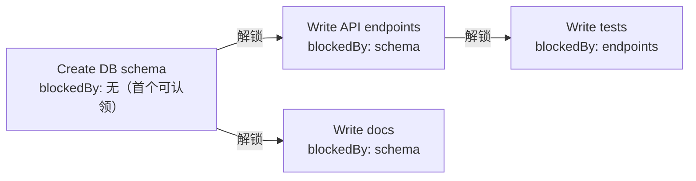
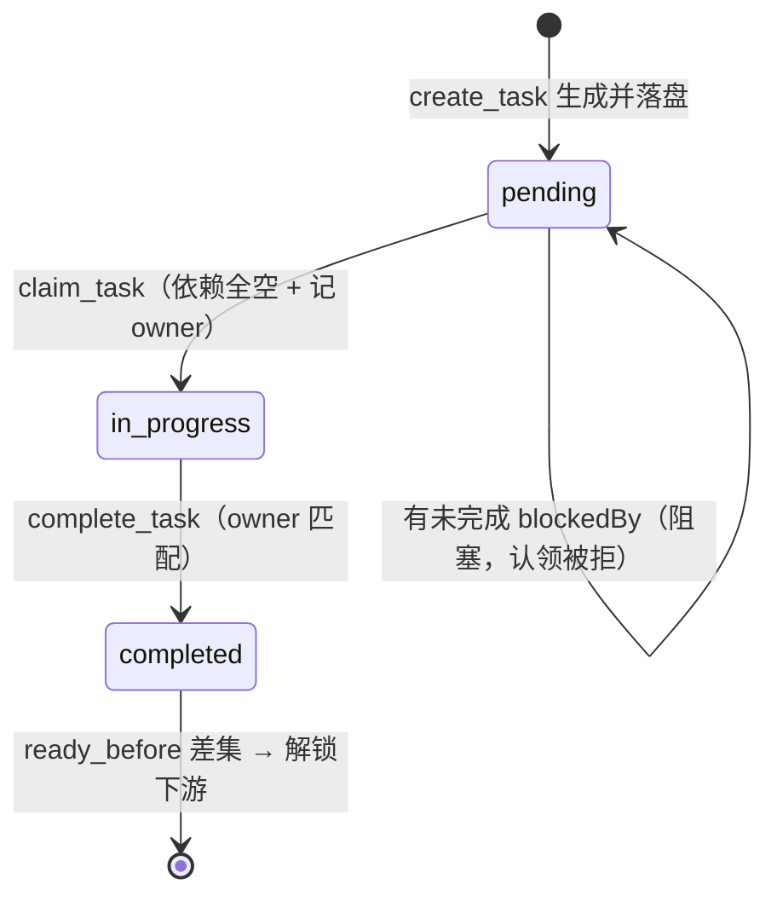

# s10 Task System — 从执行清单到可协调的任务状态

> 📖 《Learn Claude Code》章节笔记｜[← 返回主笔记](../笔记.md)｜状态：✅ 已完成（2026-10-14）

## 一、本章讲了什么（充分展开，讲透为止）

### 1. 本章要解决的问题

s05 的 TodoWrite 解决的是"提醒自己还有什么没做"：一张清单，每项只有内容和状态，活在会话内。但当工作拆成"建数据库表 → 写 API → 写测试"时，TodoWrite 暴露三个缺口：

- **没有依赖关系**：清单能显示"编写 API"未完成，但 harness 无法判断它现在**能不能开始**（数据库表建好了吗？）；
- **没有分工**：多 agent 场景下，谁在做哪件事无从记录；
- **没有持久化**：清单随进程退出消失，跨会话无法恢复进度。

本章的 Task System 把清单升级成**持久化的任务图**：每个任务有独立 ID 和状态，`blockedBy` 记录前置依赖，`owner` 记录认领者，全部落盘到 `.tasks/`。

### 2. 核心方案：文件持久化的任务 DAG

**数据结构**：每个任务是 `.tasks/{id}.json` 一个文件，`Task` dataclass 六个字段——`id`（`task_` + 8 位随机十六进制）、`subject`、`description`、`status`（pending/in_progress/completed）、`owner`、`blockedBy`。`TaskStore` 负责校验与读写：任务 ID 必须匹配正则 `^task_[0-9a-f]{8}$`（顺带杜绝路径注入），store 根目录 resolve 后必须在 WORKDIR 内。创建时用 `"x"` 排他模式打开文件，ID 撞了就重新生成（最多试 100 次）——文件系统的 O_EXCL 语义天然解决了并发创建的竞态。

**两阶段建图**——本章最精妙的设计细节，README 专门解释：任务图分两步构建，**先创建所有节点拿到运行时 ID，再用 `update_task` 添加依赖边**。为什么必须这样？因为模型可能在一条响应里并行发出多个 `create_task` 调用，而这些同级调用在任何工具结果返回前就已全部确定——此时任何 ID 都还不存在，第二个调用无法引用第一个调用生成的 ID。system prompt 里专门写了一句教模型遵守这个协议："Create all task nodes first. After create_task returns runtime-generated IDs, use update_task with those exact IDs to add dependencies." 这是"工具的局限性要用提示词补偿"的典型案例。

**🖼️ 图 1：任务依赖 DAG（这张图怎么看——箭头从"前置任务"指向被它挡住的下游：schema 一完成，endpoints 与 docs 同时解锁、可并行认领，tests 仍被 endpoints 挡着）**

**依赖校验（update_dependencies）**：修改前先整体验证——目标任务必须存在、仍为 pending 且无人认领（认领后就锁死结构）；每个依赖必须存在、不能是自身；`_depends_on()` 用 DFS 做传递闭包检查**防止成环**（给 A 加依赖 B 之前，先确认 B 不（传递）依赖 A）。校验全部通过才一次性保存。重复添加已有依赖是幂等的。

**认领与完成的状态机**：两个动作、三个状态：`pending ──claim──→ in_progress ──complete──→ completed`。

- `claim_task`：只有 pending 且 `incomplete_dependencies()` 为空才能认领——注意依赖文件**不存在也算未完成**（`except (FileNotFoundError, ValueError)` 归入 incomplete），防止指向已删除任务的悬挂依赖被误认为满足。认领设置 owner 并落盘。
- `complete_task`：只有 in_progress 且 **owner 匹配**才能完成（防越权提交）。完成后做一件贴心的事：先在完成前快照"已就绪集合" `ready_before`，落盘后再扫一遍，差集就是**刚刚被本任务解锁的下游任务**，把它们的 subject 附在返回值里告诉模型 "Unblocked: ..."——工具返回值直接驱动下一步行动（s02"返回值教模型下一步"哲学的延续）。

**🖼️ 图 2：认领状态机（这张图怎么看——真身只有 3 个状态，"被阻塞"不是独立状态而是 pending 上的条件；每次迁移都有守卫，complete 时还顺手算出刚被解锁的下游）**

**读取分层**：`list_tasks` 只给一行摘要（状态图标 `[ ]/[>]/[x]` + ID + subject + owner + blockedBy），`get_task` 才返回完整 JSON——跨会话恢复时先扫清单、再按需取详情，和 s09 记忆的"索引 + 正文"是同一个模式。

### 3. 代码走读要点（code.py，600 行）

- **循环骨架原封不动**：agent_loop 与 s04 内核逐行一致，6 个任务工具只是 TOOLS/TOOL_HANDLERS 里的新条目——dispatch map 模式（s02）的又一次红利。
- 任务工具的 schema 比基础工具严谨：`update_task` 的 `task_id` 和 `addBlockedBy` 元素都带 `pattern: "^task_[0-9a-f]{8}$"` 约束，并设 `additionalProperties: False`——在 API 层就挡住格式错误的 ID，减少一轮报错循环。
- `TaskStore.load` 做双重校验：文件里的 id 必须等于文件名推导的 id，status 必须在三值白名单内——不信任磁盘上的任何字节。
- 本章**只处理顺序执行**（README 明言）：claim 不持锁抢占、complete 没有事务，多 agent 并发抢同一任务的竞态留给真实系统。

### 4. 实战观察（沙盒实测）

在 `/tmp/lcc-s10` 沙盒实测（README 的建议 prompt）：

- **建图**：一条 prompt 让模型创建 4 个任务。模型严格走了两阶段——先并行发出 4 个 `create_task`，收到 4 个运行时 ID 后，再发 3 个 `update_task` 建边（endpoints←schema、tests←endpoints、docs←schema）。system prompt 的协议教学一次奏效，零重试。
- **认领与解锁**：让模型"认领第一个无阻塞任务并完成它"。`claim_task(task_20c658e5)` 成功（schema 无依赖），`complete_task` 返回值精确打印 `[unblocked] Write docs, Create API endpoints`——`ready_before` 差集机制工作正常；模型随即正确解读出 docs 和 endpoints 可并行、tests 仍被阻塞。
- **跨会话恢复**：退出进程重启，新会话只说 `List all tasks`，agent 从 `.tasks/` 读到 1 completed + 3 pending 的完整状态——持久化验证成功。
- **负向测试**：让新会话的 agent"尝试认领 write tests 任务"，`claim_task` 返回 `Blocked by: ['task_fbd0de11']`，模型如实报告失败并主动建议先完成 endpoints——依赖门禁在真实模型行为层面生效，不是纸面代码。

## 二、与前面章节的关系

**对 s05 的直接升级**。本章开头就用一张八行对照表与 TodoWrite 划界：TodoWrite 是"当前任务的执行清单"（进程内、无依赖、无分工、整表替换），Task System 是"可恢复的任务系统"（落盘、DAG、owner/claim、单条 CRUD）。同一章 README 把 Task System 定位为"多 agent 协作的基础"——owner 字段和 claim 动作目前只有一个 "agent" 在用，但协议已为 s13+ 的多 agent 预留。

机制层面：6 个新工具通过 s02 的 dispatch map 注册，循环骨架一行未改（s01 断言第十次验证）；权限、hooks、错误文本化等 s02-s04 的机制原样保留。值得注意的还有与 s09 的**模式呼应**：`.tasks/` 之于任务 = `.memory/` 之于知识，都是"一个实体一个文件 + 落盘 + 跨会话可读"——本书的持久化哲学一以贯之：不用数据库，文件系统就是数据库。

为什么放在 s09 之后：s09 解决"跨会话记住知识"，但知识不等于进度——复杂任务还需要记录每一步的状态和依赖。s10 是"持久化"主题的第二块拼图，且它的"慢任务"场景（全量测试、装依赖）直接引出 s11。

## 三、实战场景（怎么用）

1. **多人/多 agent 协作的任务看板**：把 `.tasks/` 提交进 git 或用共享目录，多个 agent（或人）通过 claim/complete 协议认领任务，`blockedBy` 保证没人抢到前置未完成的活——本章代码几乎可以直接改造成团队任务原语。
2. **长任务断点续跑**：让 agent 干一个跨小时的活（重构大模块），中途 Ctrl+C 后重启，新会话 `list_tasks` + `get_task` 即可恢复到具体某一步，而不是从头再来。
3. **评估编排框架**：看到任何 agent 框架的 task/workflow 抽象，用本章的最小模型去对照——有没有显式依赖图？有没有认领协议？状态落不落盘？三个问题问完就知道它的任务系统是真机制还是提示词约定。

## 四、我的思考

*（待补充——你的联想、认同与质疑写在这里）*

## 五、我的问题与解答

- ❓**为什么 `update_task` 只允许在 pending 且未认领时改依赖？任务跑着跑着发现新依赖怎么办？**
  → ✅解答：这是用灵活性换正确性的取舍。允许运行中改图会引入两个难题：①环可能在工作进行中形成，已 in_progress 的任务互相等待造成死锁；②agent 基于旧图做的计划全部失效。锁死"pending 才改图"等于规定：**图结构在动工前冻结，动工后只允许状态流动**。真实系统里"新发现的依赖"通常建模为新建一个阻塞任务（追加节点），而不是改已有节点的边——本章的约束逼你采用更不易出错的建模方式。
- ❓**`complete_task` 里"解锁检测"为什么要用 ready_before 差集，而不是直接看哪些任务的 blockedBy 包含本任务？**
  → ✅解答：差集法更精确也更通用。"blockedBy 包含本任务"只能找到直接下游，而且一个下游任务可能有多个依赖、此前早已就绪（比如它的其他依赖先完成了）；差集法回答的是真正有意义的问题——"**因为这次完成，哪些任务从不可开始变成可开始**"。代价是两次全量扫描 `list_tasks()`，任务量大时是 O(n²) 级别的文件 IO，教学实现可接受，生产上需要索引。
- ❓**多 agent 同时 claim 同一个任务会怎样？本章防得住吗？**
  → ✅解答（代码分析 + 待验证方向）：防不住，作者明言"S10 只处理顺序执行的状态更新"。竞态窗口在 `claim_task` 的 load-check-save 三步之间：两个进程同时读到 pending，都判定可认领，都写盘——后写覆盖先写，两个 agent 都以为自己认领成功。`create_task` 用了 `"x"` 排他创建解决了创建竞态，但 claim 没有对应的 compare-and-swap。可行方向：文件锁（fcntl/O_EXCL 标记文件）、原子 rename、或引入单点调度进程。这正是 s13 之后多 agent 章节需要回答的问题，读到时回来验证。

## 六、关键摘记

⭐ TodoWrite 是提醒自己的清单，Task System 是可被认领、追踪、解锁的任务图——区别在于依赖（blockedBy）、分工（owner）、持久化（.tasks/）｜⭐ 两阶段建图：同级并行 tool_use 拿不到彼此的运行时 ID，必须先建节点再连边——工具局限性用提示词协议补偿｜⭐ `ready_before` 差集：完成一个任务后，"刚被解锁的下游"才是有价值的返回值｜⭐ 依赖文件不存在 = 依赖未完成——悬挂依赖宁可阻塞不可放行｜💡 状态机只有 2 个动作 3 个状态，复杂任务系统的正确性来自克制而非丰富｜💡 文件系统就是数据库：O_EXCL 创建、逐文件 JSON、正则校验 ID

## 七、代码实战

跑通 ✅（沙盒实测：一条 prompt 两阶段建成 4 节点 DAG；claim+complete schema 后精确解锁 endpoints 和 docs、tests 保持阻塞；新会话 list_tasks 恢复全部状态；强行 claim 被阻塞任务遭拒）　改造实验 ☐（待做：手工改 .tasks/*.json 构造 A↔B 互相依赖，验证 `_depends_on` 环检测报错路径）

## 八、📚 本章拓展资料与对照（每条结合本章展开）

**1. Anthropic《Effective harnesses for long-running agents》（2025）——赞同，跨会话进度管理的生产版**

它讲了什么：Anthropic 针对"agent 要连续工作数小时甚至数天"的场景总结 harness 设计经验。核心观察：长任务必须跨越多个上下文窗口/会话，而"每个新会话开始时都对之前发生了什么毫无记忆"——像每班都换一批失忆工程师的工地。结论是光有 compaction 不够，harness 必须提供外部持久化：初始化 agent 先生成结构化的需求/任务清单文件，后续会话的 agent 靠读取这些文件（进度日志、任务清单）恢复状态、逐步推进，并保持环境整洁可验证。（已于 2026-10-14 用 curl 抓取原文验证）

与本章的对照：问题陈述几乎逐字相同——本章 README 的"程序退出后就无法继续追踪进度"就是该文"each new session begins with no memory"的教学版。本章的 `.tasks/` + `get_task` 恢复协议 = 该文"结构化清单文件 + 新会话读文件恢复"的最小实现。差异：该文的清单主要给**单 agent 跨会话**用（顺序接班），本章多了 `owner`/`claim`，把同一份基础设施延伸向**多 agent 并发**。判断：本章抓住了生产经验的最小内核——"进度必须落盘、恢复必须结构化"，claim/complete 的状态机则超出了该文范围，是面向协作的进一步抽象。

**2. Apache Airflow 官方文档：DAGs 概念页——工程平行，调度器视角的对照组**

它讲了什么：Airflow 是数据工程领域最主流的编排系统。它的核心模型：一个 Dag 封装执行一个工作流所需的全部——Task 是离散工作单元、Task Dependencies 定义任务执行的顺序与条件、还有调度、重试、超时、回调等运维属性；依赖关系用 `>>`/`<<` 声明，框架保证无环（DAG 之名）并按拓扑序调度到 worker 上执行。（已于 2026-10-14 用 curl 抓取原文验证）

与本章的对照：同构关系一目了然——`blockedBy` = upstream dependencies，`_depends_on` 环检测 = DAG 的 acyclic 保证，`can_start` = Airflow 调度器的"所有 upstream 成功才触发"。**根本差异在驱动者**：Airflow 有一个中心调度器进程持续扫描 DAG、主动派发就绪任务；本章没有调度器，是 **agent 自己**调用 `claim_task` 来"拉取"工作——推送（scheduler push）vs 拉取（agent pull）。这个差异恰恰是 agent 系统的本质：执行节奏由模型决策而非框架驱动，harness 只负责守住规则（依赖不满足就拒绝认领）。判断：本章证明了任务系统的"规则内核"（依赖校验 + 状态机）可以小到 200 行；Airflow 的其余几千倍代码量买的是调度、重试、监控、并发——那是运维复杂度，不是模型复杂度。

**3. Cognition《Don't Build Multi-Agents》（Walden Yan，2025-06）——反方：owner/claim 通往的路，人家劝你别走**

它讲了什么：Devin 团队基于自家多 agent 实践的血泪复盘，提出两条"上下文工程原则"：**Share context**（共享完整上下文，不要只传消息摘要）和 **Actions carry implicit decisions**（每个行动都携带隐性决策，多个 agent 的隐性决策会冲突）。论证核心：把工作拆给并行子 agent 时，子 agent 只拿到任务的局部描述，各自做出的架构/风格假设互相矛盾，合并时崩溃；多 agent 系统的协调成本常常超过并行收益。结论倾向：默认用单 agent + 完整上下文 + 压缩，多 agent 只在任务真正可分解且子任务无需频繁对齐时才用。（已于 2026-10-14 用 curl 抓取原文验证）

与本章的冲突：本章 README 把 Task System 明确定位为"**多 agent 协作的基础**"，`owner`/`claim` 就是为多个 agent 认领任务设计的——而 Cognition 的文章标题就是劝退多 agent。一个在给多 agent 修铁路，一个在说这条路大多不该修。

我的辩证判断：两者其实在不同的抽象层说话，冲突比看起来小。Cognition 反对的是**用消息传递切割上下文**的多 agent（子 agent 看不到全局、隐性决策冲突）；本章的 Task System 恰恰是**共享状态**的协调方式——所有任务、描述、依赖、状态都落盘在共享的 `.tasks/`，任何 agent `get_task` 就能看到完整细节，这正是 "Share context" 原则的文件系统实现！真正的分歧只在"该不该并行分工"：Cognition 说默认不该，本书说基础设施先备好、用不用是后话（s13 才会真正动用多 agent）。正确姿势：把本章的机制学成"共享任务状态"而非"消息总线"，同时把 Cognition 的警告作为动用多 agent 前的检查清单——读 s13 时回来验证作者如何处理上下文共享问题。
