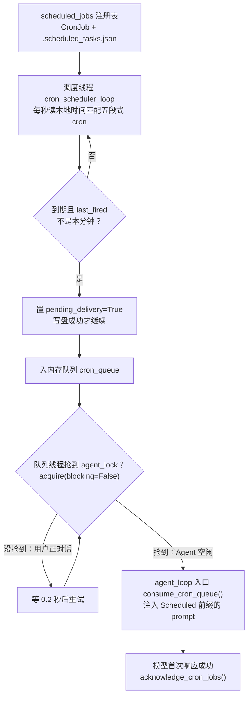
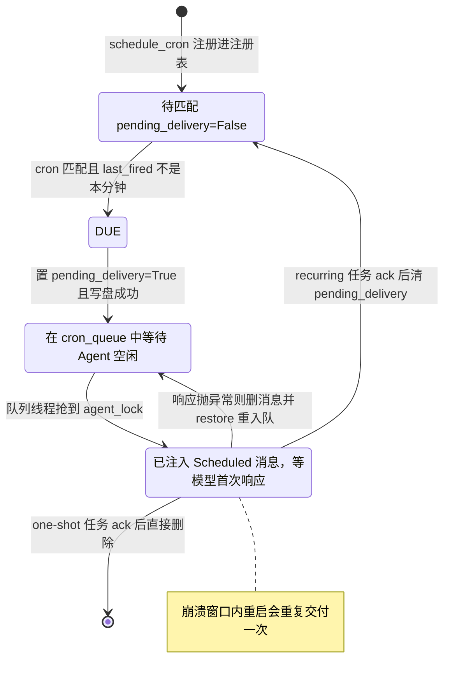

# s12 Cron Scheduler — 按时间启动任务

> 📖 《Learn Claude Code》章节笔记｜[← 返回主笔记](../笔记.md)｜状态：✅ 已完成（2026-10-14）

## 一、本章讲了什么（充分展开，讲透为止）

### 1. 本章要解决的问题

s11 的后台任务解决的是"命令开始**之后**"的事：耗时命令挪到后台跑，不阻塞对话。但它完全没有回答"**何时**开始"——没有任何组件记录一项工作应该在什么时间启动，也没有组件持续检查当前时间。"每天早上 9 点跑测试""每 30 分钟检查 CI 状态"这类请求，在纯 Agent Loop 下只能由用户到点后手动再发一遍 prompt。本章要给 harness 加上"时间"这个维度：保存执行时间 → 到点把 prompt 放进待执行队列 → Agent 空闲时启动一轮 Loop 执行它。

### 2. 核心方案：注册表 + 两条守护线程 + 一个交付状态机

方案由四块拼成，每一块职责单一：

| 组件 | 职责 | 实现 |
|------|------|------|
| `scheduled_jobs` 注册表 | 保存任务定义 | `dict[str, CronJob]`，durable 任务落盘 `.scheduled_tasks.json` |
| 调度线程 `cron_scheduler_loop` | 每秒读本地时间，匹配 cron 表达式，到期入队 | 只管"时间到了没有"，不管执行 |
| 内存队列 `cron_queue` | 缓冲到期任务 | 解耦"到期"与"交付"两个事件 |
| 队列处理线程 `queue_processor_loop` | 等 Agent 空闲（`agent_lock`），把队列里的 prompt 注入一轮新 Loop | 只管"现在能不能交付"，不管时间 |

模型侧只看到三个新工具：`schedule_cron` / `list_crons` / `cancel_cron`。值得注意的是**调度能力本身是作为工具暴露给模型的**——不是用户命令，是模型在理解"每天早上 9 点"这类自然语言后自己算出 cron 表达式并注册。本章保留 s04 的五个基础工具和 Hooks，但**故意不带入 s11 的后台命令**：因为定时任务传递的是一条待执行的 prompt，而不是某个后台命令的执行结果，两个机制正交。

**🖼️ 图 1：定时任务的四组件与交付链路（这张图怎么看——跟着箭头往下走，注意"到期"与"交付"是两个被队列解耦的独立等待：调度线程一秒都不停，队列线程只等 Agent 空闲）**

### 3. 关键机制逐条走读（code.py，790 行）

**CronJob 保存什么**（第 269-277 行）：`id / cron / prompt / recurring / durable / pending_delivery / last_fired`。后两个字段是整个交付状态机的核心：`pending_delivery` 表示"已到期但模型还没收到"，`last_fired` 是分钟级标记（`%Y-%m-%d %H:%M`），防止同一分钟内每秒轮询都重复入队。

**五段式 cron 表达式**（`_cron_field_matches` / `cron_matches`，第 285-321 行）：支持 `*`、`*/N`、`N`、`N-M`、`N,M` 五种写法。一个容易被忽略的**真实 cron 语义**：`day` 和 `weekday` 两个字段如果都不是 `*`，是 **OR** 关系（任一匹配即触发），不是 AND——代码第 315-321 行忠实地实现了这个经典（也经典地坑人）的规则。注册前 `validate_cron()` 逐字段校验取值范围，非法表达式直接拒绝，返回错误文本给模型。

**到期入队是"先持久化、再入队"**（`_enqueue_due_job`，第 481-494 行）：先置 `pending_delivery=True` 和 `last_fired`、写盘，**成功之后**才把任务放进 `cron_queue`；写盘失败则回滚状态。顺序不能反——反过来会出现"队列里有任务但注册表状态没保存"，进程一崩就丢了证据。

**Agent 空闲后才交付**（`queue_processor_loop`，第 727-735 行）：队列线程用 `agent_lock.acquire(blocking=False)` 非阻塞抢锁——用户正在对话时抢不到，就等下一轮 0.2 秒的轮询。这避免了定时回合和用户回合**同时修改同一个 messages 数组**。交付发生在 `agent_loop` 开头（第 650-654 行）：`consume_cron_queue()` 取出任务，每个包装成 `[Scheduled] {prompt}` 的 user 消息追加进会话。

**确认与失败回退**（第 656-679 行）：模型**首次响应成功**后才 `acknowledge_cron_jobs()`——recurring 任务清掉 `pending_delivery` 等待下次匹配，one-shot 任务直接删除。如果 API 调用抛异常，刚追加的 `[Scheduled]` 消息会从 messages 里删掉，任务通过 `restore_cron_jobs()` 重新放回队列、重新置 pending。这就是 README 明说的 **at-least-once 交付**：进程若在"模型已接收 prompt"和"确认状态写盘"之间崩溃，重启后同一任务会再交付一次。

**🖼️ 图 2：at-least-once 交付状态机（这张图怎么看——沿着状态迁移找"回边"：ack 失败或 API 抛异常会把任务送回待交付，正是这条回边让重复交付成为可能）**

**持久化的两个工程细节**：① `save_durable_jobs()` 用临时文件 + `os.replace()` 原子替换，文件名带 pid 和线程 id 防冲突；② `load_durable_jobs()` 加载时逐条校验（cron 合法性、id 前缀、prompt 非空），坏条目打印警告跳过，文件损坏则报错而不是静默忽略。

**权限的线程边界**（`request_permission`，第 194-203 行）：定时回合跑在队列线程里，不能和主终端抢 `input()`，所以检测到非主线程直接返回 "Permission denied: scheduled turns cannot request interactive approval"——s03/s04 的交互式审批被正确地降级为拒绝。

**明确的运行边界**（README 自己声明）：用进程本地时间；进程关闭调度即停，`durable` 只保留任务定义；重启**不补跑**停机期间错过的时间点；线程只在 CLI 主程序启动时启动，import code.py 不会带出后台线程。需要进程外可靠调度？README 直接指路：用系统 crontab / systemd timer。

### 4. 实战观察（沙盒实测）

在 `/tmp/lcc-s12` 沙盒中让模型"每分钟运行一次 `date`，recurring 且 durable"。观察到的完整链路：

1. 模型算出 `* * * * *`，调用 `schedule_cron`，stderr 打印 `[cron] scheduled cron_98d18b8d`，`.scheduled_tasks.json` 立即落盘；
2. 下一分钟边界，调度线程打印 `[cron] due cron_98d18b8d` → 队列线程打印 `[cron] delivered` → 模型收到 `[Scheduled] 运行 date 命令` → 调用 `bash(['date'])` → 输出中文总结。**连续 4 分钟触发 4 次**，完全无人干预；
3. 定时回合**完整复用主循环的一切**：PreToolUse 的 log hook、Stop 的统计 hook 都照常触发（`[HOOK] Stop: session used N tool calls` 计数随每次交付递增）——证明交付机制只是"在循环入口前注入消息"，循环本体无感知；
4. 持久化文件里能看到 `last_fired` 从 `16:01` 滚动到 `16:02`，`pending_delivery` 交付后归位 `false`；
5. 退出进程后重新启动，打印 `[cron] loaded 1 durable job(s)`——durable 任务跨重启恢复，验证通过。

一个超出文档的细节：模型在总结里主动提示"该任务每分钟都会触发一次会话，如果不再需要可以取消"——模型能理解 recurring 任务的成本含义，这是 system prompt 里 "Use schedule_cron for work that should start at a future local time" 这一句引导出的行为。

## 二、与前面章节的关系

**承 s11（Background Tasks），边界划得极干净**：s11 管"开始之后怎么跑"，s12 管"什么时候开始"。一个处理空间（执行位置），一个处理时间（启动时机）。作者刻意不把 s11 带进本章，避免两个机制在 300 行教学代码里互相稀释——这种"每章只叠加一个维度"的克制本身就是全书方法论的一部分。

**承 s03/s04（Permission/Hooks），并把它们推进到新场景**：本章直接复用 s04 的五工具 + Hooks + 权限钩子，但定时回合给权限系统出了一个新考题——**没有人在终端前时怎么办？**答案是线程检测 + 拒绝。这是权限机制第一次面对"无人值守"场景，答案方向正确（fail closed），但也暴露了局限：危险操作在定时任务里直接不可用，而不是排队等人回来审批。

**再次验证 s01 的断言**：`agent_loop` 的循环骨架（发消息→查 tool_use→执行→回喂）一行没动，所有新机制都长在循环**外面**——两条线程负责喂任务，循环入口前加了一段"消费队列注入 [Scheduled] 消息"。s01 说"机制注入点是循环的边缘"，本章是第三个证据（前两个是 s02 的工具分发和 s04 的 hooks）。

**启 s13**：调度器能在指定时间启动一轮 Loop，但这一轮仍由**一个** Agent 处理。并行拆分工作是下一章的事。

## 三、实战场景（怎么用）

1. **每日开工前自动巡检**：注册 `0 9 * * 1-5` → prompt "跑一遍测试套件并汇总 CI 状态，把结果写进 daily-report.md"。每天到工位时报告已生成。注意进程必须活着——所以这更适合常驻的 devcontainer/服务器场景，或按 README 建议改用 systemd timer + headless agent 调用。
2. **定时记忆整理**：结合 s09 的记忆机制，每小时触发一次"把本次会话的要点归档到记忆文件"，把 s09 的手动/Stop-hook 触发改成时间驱动。
3. **个人自动化中枢**：每 30 分钟检查邮件/RSS/依赖安全公告，有更新才打扰你。`recurring=false` 的一次性任务则适合"两小时后提醒我回来继续这个任务"这类延迟提醒。
4. **评估调度系统的思维框架**：拿到任何调度器（APScheduler、Celery Beat、K8s CronJob），先问四个问题：状态存哪、到期怎么发现、交付语义是 at-most-once 还是 at-least-once、错过的时间点补不补跑——本章把四个问题都演示了一遍。

## 四、我的思考

*（待补充——你的联想、认同与质疑写在这里）*

## 五、我的问题与解答

- ❓**为什么"到期发现"和"任务交付"要拆成两条线程、中间隔一个队列？直接由调度线程启动 Agent Loop 不行吗？**
  → ✅解答：三个原因。① **职责分离**：调度线程只懂时间匹配，队列线程只懂 Agent 空闲状态，任何一个的逻辑变化都不波及对方；② **并发安全**：交付需要抢 `agent_lock`（可能长时间抢不到），如果调度线程去抢锁，抢锁期间就停止了每秒的时间轮询，会错过其他任务的到期窗口；队列作为缓冲让"到期"不被"交付阻塞"拖累；③ **持久化解耦**：`pending_delivery` 状态写盘发生在入队时，交付失败可以纯内存地重新入队，两条线程共享的就是这个状态机。
- ❓**at-least-once 意味着任务可能重复执行，为什么不做成 exactly-once？**
  → ✅解答：exactly-once 在分布式/可崩溃系统里本质上是"两阶段提交"级的成本，教学代码不值当。本章的取舍是：崩溃窗口（模型已响应、ack 未写盘）内接受重复交付，换取实现简单。对应的工程缓解是**把 prompt 设计成幂等**（"检查 CI 状态并汇报"跑一次和跑两次结果一样，"给全组发邮件"则不然）。Google SRE 书对 cron 的取舍恰好相反——宁 skip 不 double（见拓展资料 1 的辩证）。
- ❓**`last_fired` 用分钟字符串去重，那秒级或亚分钟级定时怎么办？**
  → ✅解答：本章 cron 语义最小单位就是分钟（五段式 cron 本身没有秒字段），每秒轮询只是为了**及时**发现分钟边界的到来，去重粒度按分钟是对的。真要秒级调度需要换表达式格式（如 Quartz 的六段式）并把 `minute_marker` 换成更细的 marker——机制不变，粒度参数化而已。这也提醒我们：cron 语义 ≠ "定时器"，它天然是日历时间的模式匹配，不适合高精度场景。

## 六、关键摘记

⭐ 定时任务 = 注册表 + 调度线程 + 队列 + 空闲交付，四个组件各司其职｜⭐ 到期入队"先写盘再入队"，交付失败"删消息重入队"——at-least-once 是靠状态机而不是运气｜⭐ `[Scheduled] {prompt}` 作为 user 消息注入，循环本体对定时任务零感知｜💡 无人值守回合的权限策略 = fail closed（线程检测，非主线程直接拒）｜💡 cron 的 day/weekday 是 OR 语义；重启不补跑是刻意的取舍，不是缺陷

## 七、代码实战

跑通 ✅（沙盒 `/tmp/lcc-s12`：模型注册 `* * * * *` durable 任务 → 连续 4 分钟观察到 due → delivered → bash('date') → 总结的完整链路；`.scheduled_tasks.json` 落盘且 `last_fired` 滚动更新；重启进程验证 `[cron] loaded 1 durable job(s)`）　改造实验 ☐（待做：注册一个含 `rm` 的定时任务，验证非主线程权限拒绝路径）

## 八、📚 本章拓展资料与对照（每条结合本章展开）

**1. Google SRE Book 第 24 章《Distributed Periodic Scheduling with Cron》（Štěpán Davidovič，2016）——深化 + 批判视角**

它讲了什么：Google 内部分布式 cron 服务的复盘，开篇就自嘲"cron 看起来像是最基础的服务，但我们学到的教训最多"。核心内容：① 单机 cron 是单点，机器宕机时所有任务停摆，Google 用 Paxos 选主做多副本调度；② **幂等性分析**——垃圾回收类任务跑两次无妨，群发邮件类任务跑两次是事故；有些任务错过一次无妨，发工资任务错过就是事故；③ 因此 Google 的总原则是 **"宁 skip 不 double"（fail closed）**：跳过的启动可以事后补救，重复启动（比如给全公司发两遍邮件）可能无法撤回。

与本章的对照：冲突点非常精彩——本章选 **at-least-once**（宁可重启后重复交付），SRE 选 **at-most-once 倾向**（宁可漏跑不重复）。两者都对，因为任务性质不同：agent 的定时 prompt 大多是"检查/汇总"类天然幂等的读操作，漏跑的损失（用户以为系统死了）大于重复；而 SRE 面对的是发工资、发邮件这类写操作。本章"重启不补跑错过时间点"则与 SRE 完全一致——错过的就让它错过。我的判断：**交付语义没有普世最优解，它是任务幂等性的函数**；本章代码至少把这个语义写在了明处（README 专段声明），这已经好过大多数不声明语义的调度器。（已于 2026-10-14 查证原文，https://sre.google/sre-book/distributed-periodic-scheduling/ ）

**2. APScheduler 官方用户指南（Python 生态主流调度库）——赞同 + 工程对照**

它讲了什么：APScheduler 是 Python 事实标准的进程内调度库。用户指南展示的架构与本章惊人地同构：scheduler 运行时也做两件并发的事——**从 data store 取到期 schedule（对应本章调度线程）+ 把到期任务交给 executor 执行（对应队列线程）**；提供持久化 data store（SQLAlchemy/Redis/MongoDB，对应 `.scheduled_tasks.json`）；并有本章没有的两个生产级特性：**misfire grace time**（任务错过预定时间后，多久之内还允许补跑——正是本章"不补跑"策略的参数化版本）和 **coalescing**（错过的多次触发合并成一次，防止停机一小时后一次性补跑 60 次）。

与本章的对照：本章就是 APScheduler 的极简内核——把时间轮询、任务注册、原子交付三个概念剥离出来给你看。差异在完备性：APScheduler 把"补不补跑"做成 per-job 配置，本章是全局写死的"不补跑"。我的判断：教学代码的固定取舍是对的（少一个维度少一层认知负担），但生产使用时 misfire 策略是绕不开的设计点——APScheduler 的 user guide 就是本章"运行边界"那一节的完整展开。（已于 2026-10-14 查证原文，https://apscheduler.readthedocs.io/en/master/userguide.html ）
