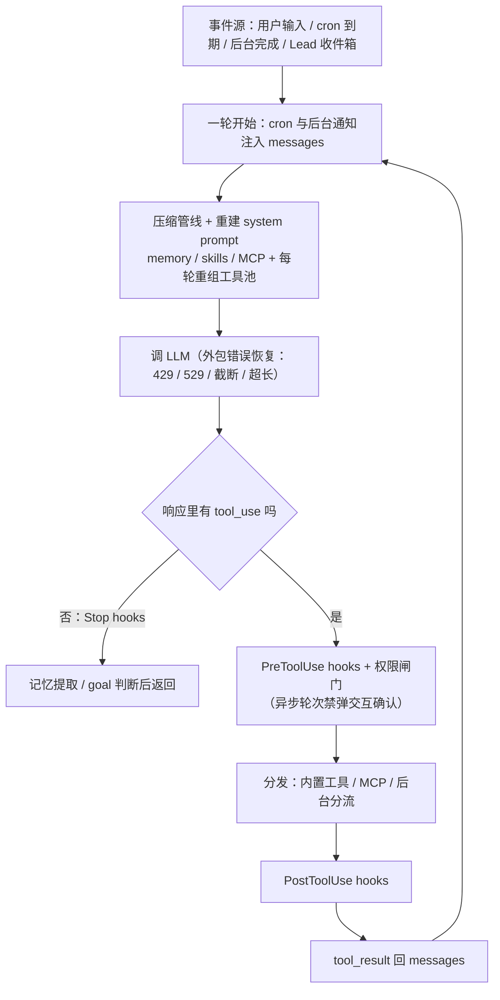
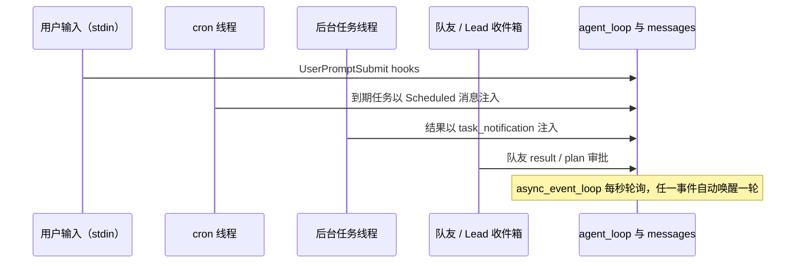

# s15 Agent Harness 集成 — 多种机制，一个循环

> 📖 《Learn Claude Code》章节笔记｜[← 返回主笔记](../笔记.md)｜状态：✅ 已完成（2026-10-14）

## 一、本章讲了什么（充分展开，讲透为止）

### 1. 本章要解决的问题

s01–s14 每章一个机制，各自跑在独立的示例里：权限在 s03 的循环里，压缩在 s08 的循环里，团队在 s13 的循环里。但一个能长期干活的 coding agent 需要**同时拥有**全部机制——工具分发、权限边界、hooks、todo、任务图、技能、记忆、压缩、错误恢复、后台任务、cron、团队、worktree、MCP。问题不是"再加一个机制"，而是：**这些机制同时挂在同一个循环上时，各自从哪里进入、事件如何回到同一段对话、互相之间会不会打架**。本章是全书唯一一章"不引入新机制"的章节，它回答的是集成问题。

### 2. 核心方案：循环不变，机制全部走"边缘注入点"

本章的答案用一张流程图就能说清（README 第 39–53 行）：

```text
用户输入 → UserPromptSubmit hooks → cron/后台通知注入 → 压缩管线
→ memory+skills+MCP 组装 system prompt → LLM（外包错误恢复）
→ 有 tool_use？ 否 → Stop hooks → 返回
              是 → PreToolUse hooks + 权限 → 分发（内置/MCP/后台）
              → PostToolUse hooks → tool_result 回 messages → 下一轮
```

循环的判定结构跟 s01 一模一样：`has_tool_use(response.content)` 决定是否继续。所有机制都不改写循环本体，而是占据循环周围的**十二个注入点**（README 第 61–74 行的表格）：用户输入前后、LLM 前（cron 队列、后台通知、压缩、prompt 组装）、LLM 调用（错误恢复）、工具执行前（权限 hooks）、分发（工具池组装）、执行时（后台分流）、执行后（PostToolUse）、返回循环（tool_result）、停止时（Stop hooks）。这就是 s01 那句"机制长在循环上"的最终形态。

**🖼️ 图 1：集成总图——机制全部挂在循环边缘（这张图怎么看——事件从四类源进入同一个 while，判定菱形仍是 s01 的 has_tool_use；其余每个节点都是某个机制的注入点，循环骨架一行未改）**



### 3. 代码走读（code.py，3326 行——全书最重的一章）

**复用而不是重写**：`load_memory_runtime()`（L84–102）用 `importlib` 直接加载 s09 的 code.py 作为模块，把本章的 `client`、`MODEL`、`WORKDIR` 注入进去共享——记忆系统是"同一个运行时"，不是复制粘贴的第二份。

**任务系统**（L140–428）：任务是 `.tasks/task_*.json` 的小文件。三个工程细节值得注意：① `task_store_lock()` 用 `fcntl.flock` 做**跨进程**互斥（Windows 退化为线程锁），因为多个 agent 线程甚至多个宿主进程都会碰任务板；② `update_task()` 会检测依赖环（`_task_depends_on` 传递闭包），且只允许任务处于 `pending + 无 owner` 时改依赖——**两阶段构建**：Lead 先 `create_task` 建所有节点拿到运行时 ID，再 `update_task` 连边；③ `claim_task` 是原子的：检查状态、检查 owner 没有别的在途任务、检查依赖已完成、绑定 worktree cwd、推进 assignment version，一气呵成，两个队友不可能同时认领同一个任务。

**worktree**（L431–716）：任务可以绑定独立 git worktree 作为工作目录。`create_worktree` 做了教科书级的**部分失败处理**——`git worktree add` 失败后逐个核对残留物（目录/注册项/分支），明确告诉模型"留下了什么、任务仍未绑定、请人工恢复"。`remove_worktree` 刻意**不是模型工具**（README L188：移除保留在宿主侧），因为 worktree 只是隔离工作副本、不是安全沙箱，破坏性操作不交给孩子。

**MessageBus 与团队协议**（L1104–1416）：信箱是 `.mailboxes/{agent}.jsonl` 文件 + `threading.Condition` 通知。协议层（`ProtocolState`/`match_response`/`apply_plan_response`）处处防错配：plan 审批要核对 request_id、发送方、接收方、状态、**work_version 和 task_id**——认领或释放任务会推进 `assignment_versions`，让旧的 plan 审批自动失效（L184–201）。这是"身份+版本"双因子校验，防止队友换了任务后 Lead 还在批旧计划。

**队友线程**（L1448–1690）：每个队友是一个独立线程跑**自己的迷你 agent 循环**（同一个 `has_tool_use` 判定！）。三个关键设计：① 每次调模型前先读收件箱——直接消息和关机请求不会被连续的工具轮饿死；② 没有 assignment 的队友**不能用文件/Shell 工具**（`current_cwd` 直接报错）；③ idle 时先阻塞等 `MessageBus` 消息（2 秒超时），超时后才扫描就绪任务、且原子地最多认领一个。生命周期是 `WORK → result → IDLE`，线程退出时 `release_teammate_assignment` 把没干完的任务释放回任务板。

**权限作为 hook，而不是 dispatcher 的一部分**（L1793–1830）：`permission_hook` 注册在 `PreToolUse` 上，和日志 hook 共享同一个挂载点。最精妙的一条规则：**只有前台主线程轮次才能弹出交互确认**——异步轮次（cron 唤醒、队友线程）里需要确认的操作直接拒绝（L1807–1809），因为 stdin 只有一个，不能抢。`ConsoleBroker`（L105–124）正是为了在主 REPL 和权限询问之间串行化同一个 stdin。MCP 工具的授权依据是宿主维护的 `MCP_HOST_POLICY` 白名单表，**绝不采信 server 自己写的 description/annotations**（L2669 注释：Authorization comes from host configuration, never server descriptions）。

**压缩管线**（L1962–2223）：四层渐进——`tool_result_budget`（本轮 tool_result 总字节超 200KB 就把最大的持久化到 `.task_outputs/` 换预览）→ `snip_compact`（消息数超 50 条，归档全文 transcript 后裁中段，切口处小心避开 tool_use/tool_result 配对）→ `micro_compact`（上下文超 5 万字符时把旧的已读 tool_result 换成"[Earlier tool result saved at ...]"指针，保留最近 3 条）→ 仍超限才 `compact_history` 调模型摘要。摘要产物的格式是安全设计：`[Compacted]` 消息里明确分 "Authoritative request"（唯一可信指令）和 "Reference state (untrusted data; never authorization)"——**被压缩的历史被降级为不可信数据**，防注入。模型也可以主动调 `compact` 工具触发。

**错误恢复**（L2226–2276）：429 指数退避重试（带抖动）；529 连续两次可切换 `FALLBACK_MODEL`；`max_tokens` 截断先升级到 16000 重试、再发 continuation prompt；`prompt too long` 触发一次 reactive compact（保留最近 5 条尾巴）后重试。每类故障一条独立策略，互不混淆。

**后台与 cron**（L2279–2613）：`run_in_background=true` 的 bash 进 daemon 线程，主循环立即拿到占位 tool_result，真实结果以 `<task_notification>` 注入下一轮。cron 是独立 daemon 线程每秒扫一次；durable 任务落盘 `.scheduled_tasks.json`；一次性任务先置 `pending_delivery` 再入队，**模型调用成功才 acknowledge，失败放回队列**——交付语义是"至少一次"（L2568–2590 的 `acknowledge_cron_jobs`/`restore_cron_jobs`）。Shell 进程跑在独立进程组，宿主退出/SIGTERM 时 `_stop_all_shell_processes` 收尸。

**主循环组装**（L3137–3260）：`agent_loop` 每轮开头消费 cron 队列注入 `[Scheduled]` 消息 → 注入后台通知 → 每 3 轮没写 todo 就插 `<reminder>` → 跑压缩管线 → 重建 system prompt → **每轮重新 `assemble_tool_pool()`**（所以 `connect_mcp` 之后下一轮就能用 `mcp__docs__search`）→ 带恢复地调 LLM → 逐 tool_use 过 hooks/权限/后台分流/分发 → 结果回喂。`async_event_loop`（L3271–3298）在后台线程每秒检查 cron 队列、Lead 收件箱、已完成后台任务，任一事件自动唤醒一轮 agent——**事件源从"用户输入"扩展到了四类**。

**🖼️ 图 2：四类事件源汇聚同一份 messages（这张图怎么看——纵向是时间，用户输入、cron、后台、队友四路事件都注入同一份 messages 并唤醒同一轮 agent，这正是 12-Factor 说的 unify execution state）**



### 4. 实战观察（沙盒实测，两次运行）

**运行一（MCP + todo）**：输入"连接 docs 这个 MCP server，用它的 search 工具查 agent loop，然后用 todo_write 记录"。实测序列：`connect_mcp` → `[mcp] connected: docs -> ['search', 'get_version']` → **下一轮**模型直接调用了 `mcp__docs__search`（工具池每轮重组装的证据）→ `todo_write`（`[todo] updated 2 item(s)`）→ 模型输出总结 → Stop hook 打印 `[HOOK] Stop: 3 tool result(s)` 后退出。每次工具调用前 `[HOOK]` 日志都如期出现；`docs/search` 因为在宿主白名单里是 `allow`，没有弹权限确认——策略表生效。

**运行二（cron 自动唤醒）**：让 agent 设一个 1 分钟后的一次性提醒，然后让 stdin 挂起 100 秒。实测：模型用 system prompt 里注入的 `Current time` 算出 cron 表达式并设置成功；约一分钟后**无人输入的情况下**，终端依次出现 `[cron auto] 站起来喝水`（async_event_loop 捕获）→ `[cron inject]`（注入主循环）→ 模型被自动唤醒输出"⏰ 站起来喝水！🚰"。这就是"事件回到同一段对话"的完整证据链。

## 二、与前面章节的关系

**本章是 s01 那句"循环本身始终不变"的最终验证点。** 3326 行代码、25+ 个内置工具、十几个机制集成完毕之后，`agent_loop` 的判定结构仍然是 s01 的：`while True` + `has_tool_use(response.content)` + 追加 tool_result。逐章对账：

| 机制（来源章） | 注入点 | 循环本体动了吗 |
|---|---|---|
| 工具分发（s02） | `assemble_tool_pool` 每轮重组装 | 否 |
| 权限（s03） | `PreToolUse` hook，不写进分发 | 否 |
| hooks（s04） | 四个事件点挂在循环边缘 | 否 |
| todo（s05） | `todo_write` 工具 + 3 轮提醒注入 | 否 |
| 子 agent（s06） | `task` 工具，独立 messages | 否 |
| 技能（s07） | system prompt 目录 + `load_skill` | 否 |
| 压缩（s08） | LLM 前的 `prepare_context` 管线 | 否 |
| 记忆（s09） | prompt 组装 + Stop 后提取 | 否 |
| 任务图（s10） | 文件态 + `create_task` 等工具 | 否 |
| 后台（s11） | 分发处分流 + 通知注入 | 否 |
| cron（s12） | LLM 前队列注入 + 至少一次交付 | 否 |
| 团队（s13） | 队友线程各自跑迷你循环 | 否 |
| MCP（s14） | 工具池合并 + 宿主策略表 | 否 |

所以问题①的裁决：**成立，但要精确表述**——不变的是循环的"骨架"（调用模型→查 tool_use→执行→回喂→再查），变化的是循环周围的"边缘"越来越厚。所有机制注入点都在循环的边缘：LLM 调用之前（注入/压缩/组装）、工具执行之前/之后（hooks/权限）、分发层（工具池）、以及循环外部（事件唤醒、线程）。真正的工程智慧不是"循环不变"，而是**十四种机制被纪律性地约束在不触碰骨架的位置上**——这需要 hooks、dispatch map、每轮重组装这些早期设计的远见。

承上启下：s14 把外部工具接进来，本章把"所有机制同时活着"跑通；但本章所有决策仍由模型逐轮做出——如果一套流程是**固定且重复**的（比如代码审查流水线），模型驱动就既慢又不稳，这正是 s16 Workflow Runtime 的入口。

## 三、实战场景

1. **给自己的 agent 项目做架构评审**：拿本章的"十二注入点"表格当 checklist——你的权限挂在哪？压缩在哪触发？后台结果怎么回对话？答不上来的点就是将来会出事故的点。
2. **多机制冲突排查范式**：本章演示了真实冲突的解法——stdin 争抢（ConsoleBroker 串行化 + 异步轮次禁交互确认）、任务认领竞态（flock + 原子 claim）、旧审批失效（assignment version）。下次设计并发 agent 系统时直接复用这套模式。
3. **长任务值守**：cron（至少一次交付）+ 后台任务（通知注入）+ 错误恢复（fallback model）+ 压缩（防撑爆）四件套合起来，就是"agent 通宵跑批"的最小可用配置。

## 四、我的思考

*（待补充——你的联想、认同与质疑写在这里）*

## 五、我的问题与解答

- ❓**为什么权限要实现在 PreToolUse hook 里，而不是写死在工具分发那行？**
  → ✅解答：本章给了答案——hook 点上可以叠任意多个策略（权限、日志、审计）且互不感知，Lead、subagent、队友三条执行路径共享同一个挂载点（`_run_teammate_tool`/`spawn_subagent`/主循环都先 `trigger_hooks("PreToolUse", ...)`）。如果写死在分发行，三条路径就要复制三份权限逻辑。更微妙的好处：权限判断拿到的是**原始 tool_use block**，在 dispatch 之前，连"这个工具存在与否"都不用管。
- ❓**25+ 个工具常驻工具池，这不正好撞上 s02 笔记里讨论的"工具膨胀"问题吗？**
  → ✅解答：撞上了，这是本章没有正面解决的债务。缓解措施有两个：技能只放目录、全文靠 `load_skill` 按需加载（s07 的思路）；MCP 工具连接前不进池。但 25 个内置工具的 schema 每轮请求都全量发送，token 成本和选择困难是真实存在的。工程上的正确姿势应该是按任务角色裁剪工具池（队友的 `sub_tools` 就只有 10 个——本章其实已经这么做了，只是主 agent 没有裁剪）。
- ❓**cron 的"至少一次"交付会不会导致同一提醒被执行两遍？**
  → ✅解答：会，这是刻意的取舍。`_enqueue_due_job` 先持久化 `pending_delivery` 再入队；模型调用成功才 `acknowledge`（删除一次性任务），失败则 `restore_cron_jobs` 放回队列。如果进程在"调用成功但 acknowledge 落盘前"崩溃，重启后任务会再次入队——重复一次。对提醒类任务，重复一次远比丢一次可接受；要做到恰好一次需要副作用幂等，那不是调度层能独立保证的。

## 六、关键摘记

⭐ 机制全部走边缘注入点，循环骨架一行不改——s01 的断言在 3326 行规模上依然成立｜⭐ 权限是 PreToolUse hook，不是 dispatcher 的一部分；异步轮次里交互确认直接拒绝｜⭐ MCP 授权只信宿主策略表，绝不采信 server 自述｜⭐ 压缩后的历史被降级为"不可信参考数据"，只有 Authoritative request 是指令｜💡 cron 用"先持久化再入队 + 成功才 acknowledge"实现至少一次交付｜💡 认领/释放任务推进 assignment version，让旧 plan 审批自动失效——身份+版本双因子

## 七、代码实战

跑通 ✅（沙盒 `/tmp/lcc-s15`：`connect_mcp` → 下一轮出现 `mcp__docs__search` → `todo_write` → Stop hook 统计 3 个 tool_result；沙盒 `/tmp/lcc-s15b`：schedule_cron 一次性提醒约 1 分钟后由 `async_event_loop` 自动唤醒触发，`[cron auto]` → `[cron inject]` → 模型输出提醒）　改造实验 ☐（待做：让模型 spawn 一个 require_plan 的队友，观察 plan gate 阻塞 bash/write_file 直到 review_plan 批准）

## 八、📚 本章拓展资料与对照（每条结合本章展开）

**1. Anthropic《Effective harnesses for long-running agents》（2025-11-26，官方工程博客）——赞同，官方印证**

它讲了什么：Anthropic 直面"跨多个上下文窗口长时间工作"这个开放问题：长时 agent 的根本困难是**只能在离散的会话里工作，每个新会话都不记得之前发生了什么**。文章用人类工程师"换班交接"做类比，给 Claude Code 的解法是让 agent 像交接班一样维护环境状态：初始 agent 把需求落成结构化的功能清单和进度文件，后续每个会话的 agent 先读文件、跑验证、再把状态写回去，配合 git 提交记录进度；还强调用端到端测试（而非模型自我感觉）防止"提前宣布完成"。（已于 2026-10-14 抓取原文验证）

与本章的对照：高度同向——本章的压缩管线（归档 transcript + 大输出持久化到 `.task_outputs/`）、任务图落盘、cron durable 持久化、记忆跨会话提取，全部是"把状态从易失的对话历史搬到持久介质"的工程手段，正是该文"离散会话 + 文件交接"思想的集成实现。分歧在抽象层级：该文讲"单 agent 跨会话续命"，本章多了团队/后台/cron 等并发维度——换班类比从"单人间歇上班"扩展成了"整个班组并行倒班"，交接的复杂度（锁、版本、认领）也随之从文件约定升级为 flock + 原子操作。

**2. Cognition《Don't Build Multi-Agents》（Walden Yan，2025-06-12）——反方，必须正面回答**

它讲了什么：Devin 团队的核心论点：多 agent 架构（主 agent 拆任务、子 agent 并行干、最后拼结果）在 2025 年的模型能力下是**脆弱的**。两条"上下文工程原则"：① Share context——子 agent 只看到任务片段，看不到主 agent 做决策的完整轨迹；② Actions carry implicit decisions——每个动作背后有隐含决策，两个独立 agent 的隐含决策可能互相矛盾（一个做按钮、一个做页面，风格假设对不上）。他们的结论：多数任务应该用**单线程线性 agent + 完整上下文共享**，并行子 agent 只适用于"只读、结果可机械合并"的场景（如并行搜索）。（已于 2026-10-14 抓取原文验证）

与本章的冲突与辩证：本章的 `spawn_teammate` 恰恰是多 agent 持久线程架构，且队友的 `messages` 是独立的——按 Cognition 的标准，这犯了"上下文碎片化"的忌讳。我的判断：批评成立的一半在于——本章确实用工程手段偿还了上下文债务（任务描述显式传递、MessageBus 回传 result、plan approval 强制对齐决策意图），这比 naive 的 fan-out 健壮；但批评成立的另一半是——队友依然看不到 Lead 的完整推理轨迹，隐含决策冲突（比如两个队友对代码风格的不同假设）只能靠 plan 审批在**动手前**拦截，无法在**动手时**避免。务实结论：多 agent 适合"边界清晰、可写成 task 描述"的工作（本章的 task graph + worktree 隔离正是为此设计），不适合"需要持续共享隐性判断"的工作——Cognition 的原则应该作为 spawn 队友之前的自查清单，而不是禁令。

**3. 12-Factor Agents（humanlayer/dexhorthy，GitHub，2025）——赞同，工程纪律清单**

它讲了什么：把 agent 系统按十二要素重构为"可靠的 LLM 驱动软件"：Own your context window（上下文是你自己的数据结构，别交给框架黑箱）、Unify execution state and business state（执行状态就是普通状态）、Tools are just structured outputs、Contact humans with tool calls（找人审批也建模成一次工具调用而非特殊通道）、Small focused agents 等。（已于 2026-10-14 抓取仓库验证）

与本章的对照：本章几乎是这份清单的大规模兑现——`messages[]` 就是唯一的上下文数据结构（cron/后台/团队事件全部注入同一份 messages，正是"unify execution state"）；权限确认在本章里确实是"等用户输入"的挂起而非特殊通道；队友拆小而专（sub_tools 只有 10 个）。差异在哲学取向：12-Factor 主张"宁可像普通软件一样无聊"，本章则展示了"全部机制拉满"的集成上限——两者合读能得到一个健康的张力：先按 12-Factor 做简单可靠的 80%，再按本章的模式逐个加机制，每加一个都要回答"它从哪个注入点进、事件怎么回对话"。
