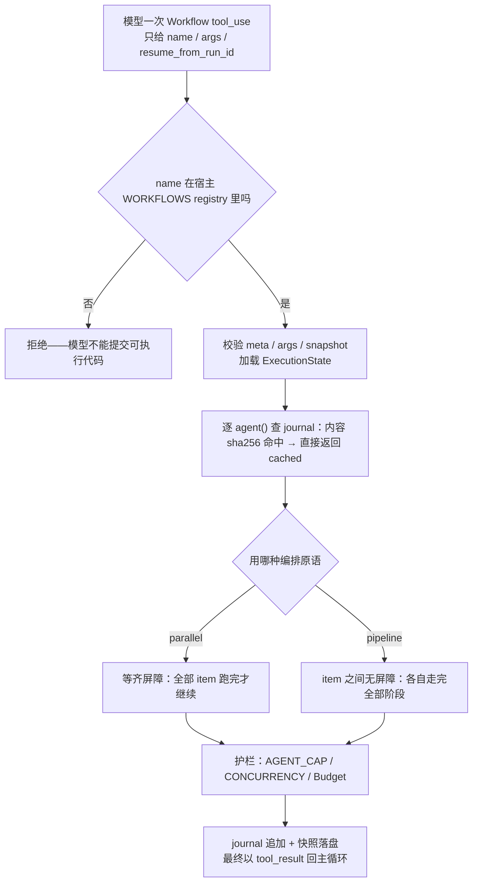
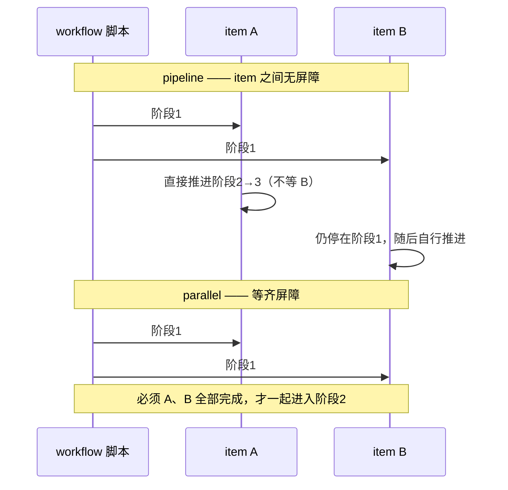

# s16 Workflow Runtime — 模型决定单步，脚本决定编排

> 📖 《Learn Claude Code》章节笔记｜[← 返回主笔记](../笔记.md)｜状态：✅ 已完成（2026-10-14）

## 一、本章讲了什么（充分展开，讲透为止）

### 1. 本章要解决的问题

s01–s15 里，每一步都是模型看着当前的 `messages[]` 临场决定下一个工具。这对"下一步取决于上一步发现了什么"的开放任务是正解。但有些任务是**固定且重复**的流程——README 举的例子是代码审查：同时按多个维度检查、逐条对抗验证每个发现、去重、按严重程度排序。这类任务用纯模型驱动有三个硬伤：

- **没有并行保证**：模型大概率串行地一个个维度查，四个维度就是四倍延迟；
- **结果结构不稳**：模型每轮的输出是自然语言，下游要再解析，格式随模型心情漂移；
- **不可恢复**：编排只存在于对话历史里，步骤顺序和中间结果也只存在于历史里——跑到一半断了，已完成的分析全部重来。

本章的回答一句话：**计划写在代码里，不是靠聊天一轮轮凑**。

### 2. 核心方案：Workflow 工具——一次 tool_use，跑完一整套编排

在 s15 宿主的工具池里加一个 `Workflow` 工具。模型能给的只有三样东西：workflow 的**名称**、`args`、可选的 `resume_from_run_id`——**模型不能提交可执行代码**，只能从宿主注册的 `WORKFLOWS` registry 里选可信脚本。这个信任边界是本章的第一块基石：编排逻辑是宿主代码，模型的角色降级为"决定何时运行哪个编排、给它什么输入"。

脚本拿到一个 `ExecutionState` 上下文，只暴露六个编排原语（README L102–109）：

| 原语 | 语义 |
|------|------|
| `agent(prompt, {schema, label, phase})` | 派一个子 agent 干一步 |
| `parallel(thunks)` | **等齐屏障**：全部并行跑完才往下走 |
| `pipeline(items, *stages)` | 每个 item 独立走完所有阶段，**item 之间无屏障** |
| `phase(title)` / `log(message)` | 进度阶段与日志（事件流） |
| `workflow(name, args)` | 嵌套子工作流（限一层，共享 journal/budget/计数器） |

`parallel` 和 `pipeline` 的区别是本章最容易被低估的设计：`pipeline` 里 item A 跑到第 3 阶段时 item B 可能还在第 1 阶段（代码 L518–527，每个 item 一个 `run_item` 协程，`asyncio.gather` 汇合）；只有"下一步必须同时用到上一步全部结果"时才该用 `parallel` 等齐。

**🖼️ 图 1：Workflow 执行与 resume 流程（这张图怎么看——信任边界在第一个菱形：模型只能从宿主 registry 里选脚本；journal 的 sha256 命中即 cached，正是 resume 零成本的原因；parallel 与 pipeline 的屏障语义在此分叉）**

**🖼️ 图 2：parallel 等齐 vs pipeline 无屏障（这张图怎么看——只看一处差别：parallel 有等齐屏障、pipeline 没有；选错原语，四个维度就不是并行而是排队）**

### 3. 代码走读（code.py，888 行）

**稳定调用键（resume 的灵魂）**：每个 `agent()` 调用算一个语义 key——`f"{kind}|{label}|{prompt}|{json.dumps(schema, sort_keys=True)}"` 的 sha256（L360–364）。两个细节：① 用 `hashlib.sha256` 而不是 Python 内置 `hash()`，因为后者每个进程加盐，跨进程 resume 就全错位了（L52–55 的注释专门点了这个坑）；② key 基于**调用内容**而不是"第几个完成"——`parallel`/`pipeline` 里完成顺序是不确定的，用序号当 key 两次运行就对不上。resume 时脚本**重新执行**，但 `agent()` 先查 journal 缓存，命中就直接返回缓存值（L471–482），只有改过的调用才真正运行。

**Journal + 快照 + 锁（存储三件套）**：每次运行在 `.runtime/` 下产生 `<runId>.json`（快照：workflow 名、args、任务状态）、`<runId>.output.json`（结果）、`<runId>.journal.jsonl`（追加式调用日志）、`<runId>.lock`（协调文件）。`reserve_run_id` 用 `O_CREAT|O_EXCL` 排他创建来预留 runId；`workflow_run_lock` 是**线程锁 + fcntl.flock 双层**——同一进程的同一线程不重复进入，另一进程也不能同时 resume 同一次运行（L96–124）。journal 是 append-only，每条 `record()` 立即 `flush()`——崩溃后已完成的调用一条不丢。resume 前先校验快照（workflowName 匹配、args 与首次运行一致，L563–572），防止拿 A 运行的 journal 续跑 B 的参数。

**结构化输出：子 agent 回来不许写散文**（L491–504）：`agent({schema})` 要求返回匹配 schema 的 JSON，`SimpleJsonSchema` 校验失败就**重试一次**（prompt 追加 "Return valid JSON."），再失败抛 `WorkflowInputError`。README 的注脚很精辟："s05 说工具的参数不能全信；这里反过来——子 agent 的输出也不能全信。" 不确定性被挡在编排层外面，下游代码拿到的永远是对象。

**护栏三件套**：`AGENT_CAP=1000`（单次运行 agent 调用硬上限，防脚本失控刷 API）；`CONCURRENCY=8` 信号量（并行上限）；`Budget`（token 预算，超支直接 raise 而不是默默超花，L379–398）。

**宿主集成方式值得单独说**：`install_workflow_tool(host)`（L786–802）**不改 s15 的任何一行代码**——它包住 s15 的 `assemble_tool_pool`，在返回的 tools/handlers 里追加 `Workflow`。同步的宿主 dispatcher 和 async 的 workflow 运行时之间用 `run_workflow_sync` 桥接（`asyncio.run`，L778–784）。这是"机制长在循环上"的最后一次展示：连编排引擎都只是工具池里多出来的一行。

**任务生命周期事件**：`async_launched` → `task_started` → 一串 `task_progress`（phase 切换、子 agent 启动/完成/cached、日志）→ `task_notification`（completed/failed + agents/tokens 用量 + 输出文件路径）。进度事件是给 UI/CLI 消费的，中间结果存在变量里**不进对话历史**——只有最终结果作为 tool_result 回到主循环。

### 4. 实战观察（沙盒实测，三次运行）

**demo + resume（MockAgentRunner，确定性）**：`python code.py demo` 跑 `review-changes`——4 个维度 audit + 7 条 findings 的 verify，共 11 个 agent 调用、883 tokens，事件流里能清楚看到 pipeline 无屏障的证据：`workflow_phase title=Verify` 在 `audit:security` 完成**之前**就出现了（correctness 维度的 verify 已经开始，其他维度还在 audit）。随后 `python code.py resume`：11 个 `agent()` 全部命中 journal 缓存，每个事件标 `status=cached`，最终统计 **agents=0 tokens=0**——断点续跑零成本，与 README 承诺一致。

**live REPL（真实 API）**：让模型审查一段有 SQL 注入的代码，模型自主选择了 `Workflow` 工具并正确填充 `args.changes`。两个意外收获：① 第一次运行 10 个 agent、确认 6 个发现（四个维度都独立查出了 SQL 注入，对抗验证确认）；② 因管道输入的多行代码被 REPL 拆成了多轮提问，意外产生了第二次运行——这次只有 1 个维度的 audit 报出发现，且**verify 阶段把它否决了**（`confirmed 0 real finding(s)`）。同一个 workflow 两次运行结果不同，恰好展示了对抗验证层的价值：它真的在过滤不稳定/不可靠的发现，而不是走过场。另外第二次运行的巨大 JSON tool_result 把上下文顶过了 5 万字符阈值，s15 的 `compact_history` 真实触发（`[compact] transcript saved`）——集成宿主的安全网在 live 模式下兜了底。

## 二、与前面章节的关系

**本章正面回答 s01 留下的第二个待验证问题：这本书最终是否承认编排的价值？答案是：明确承认，且用一整章来安放它。**

s01 的立场是"一个循环就够了"、编排派是"提示词水管工"；s16 的章题是"模型决定单步，脚本决定编排"——这不是打脸，是**分工**。README L13–21 把判据讲得很清楚：后续路径取决于上一步发现了什么 → 模型循环；步骤及其先后关系执行前已知 → 代码编排。workflow 解决的三件事（并行、稳定结构、可恢复）恰好是纯模型循环的三个结构性短板，而这三件事**本质上不是智能问题，是工程保证问题**——再强的模型也不能保证"四个维度真的并行跑了""跑到一半能续"。

更精妙的是安放方式：workflow **不是替代循环，而是循环里的一个工具**。主循环骨架一行没改（s15 的 `agent_loop` 原样运行），编排引擎通过 `assemble_tool_pool` 包装进工具池，一次 `tool_use` 调用启动整个运行时，中间过程不进对话，结果以 tool_result 回归。所以 s01 断言的最终形态是：**"一个循环就够了"在架构层面仍然成立——编排被收编为循环的一个工具，而不是与循环平级的另一种架构**。这也回应了 s01 笔记里对 LangGraph 的辩证：图 = 循环 + 显式状态管理，而本书的答案是"循环为主，需要显式状态管理的地方（journal/resume）就在工具内部做"。

与相邻章：s06 的 `task` 子 agent 是"模型临场派一次"，本章是"脚本化、可续跑的 N 次调用"，通过同一个 agent-runner 边界执行；s12 的"启动前校验 cron 表达式"思路在本章复现为"启动前校验 meta/args/snapshot"；结构化输出校验是 s05"工具参数不能全信"的镜像。承下：workflow 能告诉你"这批活儿干完了"，但"整件事是否达成用户的目标"是另一个问题——s17 的 Goal Loop。

## 三、实战场景

1. **CI 里的 AI 代码审查**：本章的 `review-changes` 可以直接改造进 CI——每次 PR 跑同一个 workflow，audit+对抗验证两阶段过滤误报，journal 让超时的运行下次 resume 而不是重跑（省钱），结构化输出让结果直接进 PR 评论模板。
2. **批量重复任务的省钱公式**：识别你团队里"每周都在做、步骤固定"的 agent 任务（发版检查、依赖升级巡检、日志周报），把它们从"每次跟 agent 聊一遍"改成保存的 workflow——模型调用次数从不可控变成可预算（`Budget`），结果从散文变成 JSON。
3. **评估编排框架时的问题清单**：拿本章的四个设计去问任何 workflow 框架——resume 的 key 稳不稳（基于内容还是顺序）？存储是不是 append-only + 崩溃安全？子任务输出有没有 schema 校验？模型能不能注入可执行代码（信任边界在哪）？

## 四、我的思考

*（待补充——你的联想、认同与质疑写在这里）*

## 五、我的问题与解答

- ❓**journal 的 key 是 prompt 内容的哈希——那我改了 prompt 里一个字，是不是整个 workflow 从头重跑？缓存粒度会不会太粗？**
  → ✅解答：key 是**每个 `agent()` 调用各自算的**，不是整个 workflow 一个 key。改了一个 audit 的 prompt，只有那一个 `agent()` 的 key 变化、重跑；其他维度和其他阶段的缓存照样命中（除非后续步骤的 prompt 里嵌了它的结果——那是真实依赖，重跑是对的）。粒度是"调用级"，恰到好处。真正的粗糙处在反面：prompt 里如果嵌入了**易变的非语义内容**（时间戳、随机 ID），key 每次都变，缓存永远 miss——所以写 workflow 脚本时要保证 prompt 是输入的纯函数。
- ❓**schema 校验失败为什么只重试一次，而不是循环重试到对为止？**
  → ✅解答：从工程上，一次重试覆盖了"模型偶发格式漂移"这个主因（绝大多数失败是 markdown 围栏、前后多了散文这类，重试提示专门修了这点）；如果连错两次，大概率是 prompt/schema 本身设计有问题（模型根本理解不了要什么），继续重试只是烧钱。从原则上，这符合全书的错误哲学：可恢复的错误给一次自愈机会，结构性错误快速失败、抛给编排层（`WorkflowInputError`），让 workflow 失败并留下 journal 供人检查——而不是让不确定性在循环里无限放大。
- ❓**为什么模型只能从 registry 选 workflow，不能提交脚本？让模型现场写编排不是更灵活吗？**
  → ✅解答：这是刻意的信任边界，至少三重理由：① 安全——脚本在宿主进程里以完整权限执行，模型生成代码等于把提示注入的攻击面开到最大；② 可靠性——workflow 的全部价值在于"固定、可测、可 resume"，现场生成的编排每次都不一样，journal 缓存和测试都失去意义；③ 责任——保存的 workflow 经过人类 review，是组织的可信资产；模型的职责是识别"这个任务匹配哪个已知编排"。灵活性的出口是 `args`——参数化空间留给模型，控制流留给代码。

## 六、关键摘记

⭐ 计划写在代码里，不是靠聊天一轮轮凑｜⭐ resume 的 key 必须是内容的稳定哈希，不能用并发完成顺序（且 Python 的 `hash()` 每进程加盐，必须用 sha256）｜⭐ 子 agent 的输出和工具的参数一样不能全信——schema 校验 + 一次重试把不确定性挡在编排层外｜⭐ workflow 是循环里的一个工具，不是循环的替代品——编排被收编，不是平反｜💡 parallel 是等齐屏障，pipeline 的 item 之间无屏障——选错原语等于白并行｜💡 模型只给 name/args/run_id，可执行代码永远来自宿主 registry

## 七、代码实战

跑通 ✅（沙盒 `/tmp/lcc-s16`：`demo` 运行 11 agents / 883 tokens，事件流可见 pipeline 无屏障交错；`resume` 全部 11 个调用命中 journal 缓存，agents=0 tokens=0。live 模式 `/tmp/lcc-s16-live`：模型自主选择 Workflow 工具审查 SQL 注入代码，第一次运行 10 agents / 5215 tokens / 确认 6 个发现；第二次运行对抗验证否决了唯一发现（confirmed 0），且巨型 tool_result 触发了 s15 的 `[compact]` 真实压缩）　改造实验 ☐（待做：修改 DEMO 的 prompt 一个字后 resume，验证只有受影响的 `agent()` 调用重跑）

## 八、📚 本章拓展资料与对照（每条结合本章展开）

**1. Anthropic《Building Effective Agents》（2024-12-19）——学术源头 + 本章的理论母体**

它讲了什么：这篇被广泛引用的博客给出了行业最经典的二分定义：**workflow** = LLM 和工具通过预定义代码路径编排的系统；**agent** = LLM 动态指挥自己的流程和工具使用的系统。它把 workflow 排成五种模式（提示链、路由、并行化、orchestrator-workers、评估器-优化器），并反复强调"先找最简单的方案，只在需要时才加复杂度"，agentic 系统是用延迟和成本换任务表现。（已于 2026-10-14 抓取原文验证）

与本章的对照：本章就是这组定义的工程落地——`review-changes` 恰好是"并行化 + 评估器-优化器"两种模式的组合（4 维度并行 audit，verify 子 agent 对抗评估每条 finding）。更重要的是本章给这个抽象二分补上了**缺失的工程血肉**：Anthropic 说了"workflow 用预定义代码路径"，没说路径断了怎么续、子任务输出格式飘了怎么办——journal/稳定 key/schema 校验就是答案。s01 笔记曾指出本书比 Anthropic 激进（"一个循环就够了" vs "workflow 有正当位置"），s16 证明这不是立场分歧而是**叙事策略**：先破（s01 拆掉框架迷信）后立（s16 在循环之内安放编排），终点与 Anthropic 的冷静殊途同归。

**2. Temporal 的 Durable Execution（Temporal 官方文档/工业实践）——赞同，同构的工业级先驱**

它讲了什么：Temporal 是工作流编排的工业标准之一，核心概念 "durable execution"：工作流代码写成普通函数，运行时把每次外部调用（activity）的结果记入 **Event History**（追加式事件日志）；worker 崩溃后，新 worker **重放**同一份代码，遇到已完成的事件直接从历史取结果而不重新执行——因此流程代码可以跑几天几周、跨进程崩溃而语义不丢。（已于 2026-10-14 抓取 docs.temporal.io 验证其文档结构含 Event History / Durable Execution 体系）

与本章的对照：逐条同构——journal ≈ Event History，resume 重跑脚本 + 缓存命中 ≈ replay，`agent()` 调用 ≈ activity，稳定内容 key ≈ Temporal 要求 workflow 代码确定性（deterministic）的原因：**重放时第 N 次调用必须对应历史上第 N 条记录**。差异也是信息量所在：Temporal 用"执行顺序"做对应（因此禁止 workflow 代码里有非确定性），本章因为 `parallel`/`pipeline` 的完成顺序天然不确定，改用**内容哈希**做对应——这是 agent 编排对传统 durable execution 的一个真实变体。我的判断：本章是"800 行实现 durable execution 的核心思想"，Temporal 是把它做到生产级（含可视性、重试策略、信号）；学完本章再读 Temporal，每个概念都有落点。

**3. Rich Sutton《The Bitter Lesson》（2019）——反方，必须正面回答**

它讲了什么：AI 七十年最苦的教训：凡把人类领域知识**手工结构**进系统的做法（手工特征、手工语法、手工搜索启发式），长期都输给了"更多算力 + 更通用的学习方法"。研究者的倾向是在自己理解的基础上做聪明的工程，但历史反复证明，能随算力缩放的通用方法（搜索和学习）最终碾压手工结构。（已于 2026-10-14 抓取原文验证标题与内容）

与本章的冲突与辩证：本章的 workflow 恰恰是把人类对"代码审查该怎么做"的知识手工结构进了脚本——按 Bitter Lesson 的历史规律，随着模型变强，这类编排是会溶解的脚手架：未来的模型可能自己就并行、自己就记得验证、自己就不需要 journal。这个批评必须认真对待，但我的判断是**批评错了一半**：① Bitter Lesson 针对的是"用手工知识替代学习"，而本章的编排替代的不是智能而是**工程保证**——并行度、可恢复性、预算上限、信任边界，这些不是模型能力的函数，模型再强也保证不了"崩溃后续跑"；② 历史规律内部的正确推论其实是：workflow 里**会溶解的是语义部分**（分几个维度、怎么验证——这些确实会随模型变强而被内化），**不会溶解的是机制部分**（持久化、锁、预算——它们本来就不依赖智能）。所以对本章的正确读法不是"编排万岁"，而是：把编排当作**当前可靠性经济学下的理性选择**，同时预期其中"教模型怎么干活"的部分有保质期。这与 Anthropic 那句"只在需要时加复杂度"合流：编排值得写，但要写得薄、写得可删。
