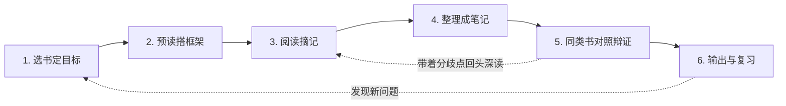

# 读书笔记工作流程

> 适用场景：通用读书笔记（不限书籍类型）
> 目标：从"读完就忘"变成"读完能用"

---

## 一、总览：六步流程



| 步骤 | 核心动作 | 产出物 | 建议用时 |
|------|----------|--------|----------|
| 1. 选书定目标 | 明确"为什么读这本书" | 阅读目标（1~3 条） | 5 分钟 |
| 2. 预读搭框架 | 看封面/目录/序言/结论 | 全书结构草图 | 15~30 分钟 |
| 3. 阅读摘记 | 边读边标记，只记"触发点" | 划线 + 便签（碎片化） | 阅读全程 |
| 4. 整理成笔记 | 用自己的话重写，结构化归档 | 一篇完整读书笔记 | 1~2 小时 |
| 5. 同类书对照辩证 | 搜同主题的书，比对观点、深读分歧处 | 对照表 + 自己的判断 | 按主题投入 |
| 6. 输出与复习 | 讲给别人/写心得/定期回顾 | 分享内容 + 复习记录 | 持续 |

---

## 二、每步详细说明

### 第 1 步：选书定目标

读书前先回答三个问题，写在笔记开头：

1. **我为什么读这本书？**（解决什么问题 / 满足什么好奇）
2. **我想从中带走什么？**（1~3 个具体目标）
3. **这本书值得怎么读？**（精读 / 泛读 / 跳读）

确定要读后，**先在 `读书笔记/` 下建本书的独立目录**（如 `读书笔记/《书名》/`），从 `_模板` 复制出 `笔记.md`——之后这本书的一切产出只放这个目录（详见"四、文件组织"）。

> 💡 没有目标的阅读，大部分内容会在一周后遗忘。

### 第 2 步：预读搭框架

不要从第一页开始闷头读。先花 15~30 分钟：

- 看**封面、封底、腰封**：这本书的核心卖点是什么
- 看**目录**：画出全书结构（章节之间什么关系）
- 看**序言/前言**：作者想解决什么问题
- 看**结论/后记**：作者的最终观点是什么

产出：一张简单的结构草图（几行字即可），后续阅读时往里"填肉"。

### 第 3 步：阅读摘记

阅读中只做轻量标记，**不要打断心流去写长笔记**：

| 标记符号 | 含义 |
|----------|------|
| ⭐ | 核心观点 / 金句 |
| ❓ | 有疑问、不认同、待查证 |
| 💡 | 启发了我自己的想法 |
| ✅ | 可以直接行动/应用的方法 |

**关键原则**：
- 摘记只记"触发点"（页码 + 关键词），正式整理留到第 4 步
- **每读完一章，回答"每章三问"**（写进模板的章节笔记）：
  1. 这一章讲了什么？（先口头 2~3 句概括练费曼；**写进笔记时充分展开、讲透为止，不为精简而精简**——问题、方案、原理、代码/细节、自己的观察，该有的都要有）
  2. **它和前面的章节是什么关系？**（是递进、展开、举例、还是转折？说清"为什么作者把它放在这里"）
  3. **它能用到什么实战场景？**（工作/生活/项目中具体怎么用，哪怕只写一条）
- **每读完一章，做好"每章两记"**：
  1. **记思考**：这一章让我想到什么？认同/不认同什么？为什么？（这是你自己的思考，比摘抄更有价值）
  2. **记问题**：没看懂的、存疑的、想深究的，都记下来——**每个问题必须跟着一个"解答"位**，可以在本章末、读完全书、或第 5 步对照阅读时补上答案；暂时解答不了的标注"待解"，带着它继续读
- **每章一搜（深入读时必做）**：为本章核心主题搜 1~3 篇权威资料（论文 / 官方文档 / 优质博客），与本章观点对照，记入章节笔记的「📚 本章拓展资料与对照」——每条标清关系（学术源头 / 赞同 / 反方）。**每条资料要结合本章详细展开：它具体讲了什么、与本章哪里一致/冲突、你的判断是什么**，不写一句话摘要式对照。**反方资料必找**，没有反方就没有辩证
- 遇到💡想法立刻记下，灵感稍纵即逝

> 💡 章节之间"串不起来"，往往是没读懂的信号；说不出实战场景，说明只是"知道了"而不是"会用了"。
> 💡 **提问比记住更重要**：没有问题 = 没有真正的阅读。问题得到解答的那一刻，知识才真正变成你的。

### 第 4 步：整理成笔记（核心步骤）

读完后 48 小时内整理（趁记忆还新鲜），按模板结构来：

1. **先复述**：合上书，凭记忆写全书讲了什么（想不起来的再翻书，印象更深）
2. **再结构**：核心观点、论证逻辑、重要概念；把各章的"每章三问"串起来，画出章节之间的逻辑主线
3. **解问题**：检查各章记下的问题——能答的当场解答写上；答不了的标注"待解"，留给第 5 步对照阅读或后续查证
4. **做沉淀**：把各章**解答过的问题、验证过的思考、可复用的干货**，提炼进笔记的"核心内容"——**沉淀的标准是"用自己的话、能在别的场景用出来"**，只对你有意义的知识才写进去，不是越多越好
5. **后连接**：这本书和我已知的什么有关？和其他书有什么异同？
6. **落行动**：哪些可以马上用？列 1~3 条行动项（可从各章的实战场景里挑）

> ⚠️ 整理时**必须用自己的话**。复制粘贴的摘抄 ≈ 没读。

### 第 5 步：同类书对照与辩证深读

> 适用时机：这本书是某主题的核心读物、你要在这个领域建立判断力，或你对书中观点有强烈疑问时。泛读的书可跳过。

**① 搜同类书（挑 2~4 本对照）**

- 豆瓣：看该书的"喜欢这本书的人也喜欢"+ 主题书单 + 热门长评里提到的书
- 微信读书/得到：相关推荐、书单、讲书稿里引用的书
- 知乎/公众号：搜"XX 主题 书单""XX 书 批判"
- **GitHub：**
  - 搜"awesome + 主题"（如 `awesome-books`、`awesome-self-improvement`），有大量社区维护的精选书单仓库
  - 免费书籍仓库：如 `EbookFoundation/free-programming-books`（技术类最全）、各类 `free-XX-books` 仓库
  - 搜书名/主题关键词，看他人公开的读书笔记仓库（README 里常有对比多本书的总结），顺便看别人怎么做笔记
- **最优质来源：书本身的参考文献、注释和作者反复引用的书**

**② 选书要"正反合"**

| 类型 | 作用 |
|------|------|
| 观点相同/互补的书 | 验证本书观点的边界和适用范围 |
| **观点相反/批评的书（必选）** | 没有反方，就没有辩证 |
| 综述/教材类的书 | 提供该领域的全局框架 |

**③ 辩证对比方法**

1. 列**对照表**：同一个问题，各本书分别怎么说（填进模板的"同类书对照"表）
2. 找**分歧点**：观点冲突的地方，才是值得深读的地方
3. 挖**分歧根源**：是证据不同？时代背景不同？立场/利益不同？还是概念定义就不同？
4. 形成**自己的判断**：你支持哪方、为什么，或者"在什么条件下谁对"

**④ 带着分歧回头深读**

- 回到原书重读关键章节，这次你是"带着对手的质询"在读，理解会深一个层次
- 把新发现补进笔记的"我的疑问与异议"和"同类书对照"部分

> ⚠️ 只读一本书就下结论，等于只听了原告的证词就判案。

### 第 6 步：输出与复习

**输出（任选一种）**：
- 写一条 200 字读后感发朋友圈/微博/豆瓣
- 给同事/朋友讲一遍这本书
- 写一篇完整书评或公众号文章

**复习节奏**（对抗遗忘曲线）：

| 时间 | 动作 |
|------|------|
| 整理后第 2 天 | 快速扫一遍笔记（5 分钟） |
| 第 7 天 | 只看"行动项"和"我的想法" |
| 第 30 天 | 尝试凭记忆复述全书框架 |
| 第 90 天 | 判断：这本书的笔记还值得保留吗？（断舍离） |

---

## 三、读书笔记模板（直接复制套用）

> 📁 模板文件：`读书笔记/_模板/笔记模板.md`，每本新书复制一份到自己的独立目录。

```markdown
# 《书名》读书笔记

- **作者**：
- **阅读日期**：YYYY-MM-DD ~ YYYY-MM-DD
- **阅读方式**：精读 / 泛读 / 跳读
- **推荐指数**：⭐⭐⭐⭐⭐（1~5）

## 🎯 阅读目标（读前写）
1.
2.

## 🗺️ 全书结构（预读后写）
- 这本书讲了什么？（一句话）
- 结构框架：
  - 第一部分：...
  - 第二部分：...

## 📖 章节笔记（每章一个独立 md，放 `章节笔记/` 目录；此处只留索引）

| 章节 | 文件 | 状态 |
|------|------|------|
| 第 X 章 | [章节笔记/第X章-主题.md](章节笔记/第X章-主题.md) | ⬜ 未开始 |

> 每章文件从 `读书笔记/_模板/章节笔记模板.md` 复制，按"三问 + 两记 + 一搜 + 实战验证"填写。

## 📝 核心内容（读完后凭记忆写，再补充）

### 核心观点
1.
2.
3.

### 重要概念 / 金句
> 原文摘抄（标注页码 Pxx）

我的理解：

### 我的疑问与异议
- ❓

## 💡 我的思考与连接
- 这本书让我想到……（关联其他书/自己的经历）
- 我不同意作者的地方是……

## 📚 同类书对照与辩证（深入读时做）

| 对照书 | 作者 | 与本书关系（赞同/反对/互补） | 同一问题上的说法 | 关键分歧点 |
|--------|------|------------------------------|------------------|------------|
| 《》 | | | | |
| 《》 | | | | |

- 分歧的根源是（证据/时代/立场/定义）：
- 我的最终判断（支持谁、为什么、或"什么条件下谁对"）：
- 回头深读后，对原书的新理解：

## ✅ 行动清单
- [ ] 本周内做：
- [ ] 本月内做：

## 📅 复习记录
- [ ] 第 2 天（日期：）
- [ ] 第 7 天（日期：）
- [ ] 第 30 天（日期：）
- [ ] 第 90 天（日期：）

## ✍️ 一句话总结（30 天复习时写）
如果只能记住这本书的一句话，是：

## 🔄 流程复盘（读完这本书后填）
- 哪个环节这次帮我最大？
- 哪个环节卡壳/流于形式/被跳过了？为什么？
- 下次流程要改什么？（更新到流程文档和模板）
```

---

## 四、文件组织：一本书一个独立目录

**铁律：每本书在项目空间下有一个独立目录，与这本书相关的一切只放这个目录里，防止不同书的笔记互相污染。**

### 目录结构

```
读书笔记/
├── 读书笔记流程.md           # 本方法论（公共文档）
├── _模板/
│   ├── 笔记模板.md           # 新书从这里复制（主笔记）
│   └── 章节笔记模板.md       # 每章从这里复制
├── 《书名A》/                 # ← 一本书 = 一个独立目录
│   ├── 笔记.md               # 主笔记（从模板复制：目标/结构/章节索引/核心内容/行动清单/复盘）
│   ├── 章节笔记/             # 每章一个独立 md（从 _模板/章节笔记模板.md 复制）
│   │   └── 第X章-主题.md
│   ├── 摘记.md               # 阅读中的碎片摘记（可选，量大时单列）
│   ├── 对照阅读/             # 同类书对照材料（可选）
│   └── 素材/                 # 截图、书摘图片、引用资料（可选）
├── 《书名B》/
│   └── 笔记.md
└── ...
```

### 隔离规则

1. **只进不出**：一本书的笔记、摘记、问题、素材，全部放自己的目录，绝不写到别的书的目录里
2. **引用不复制**：对照阅读提及其他书时，只记"书名 + 观点 + 页码"，不大段复制对方内容；那本书正式读时，建它自己的独立目录
3. **公共的才放外面**：跨书通用的方法论、经验总结，放到 `读书笔记/` 根目录的公共文档，不放单书目录
4. **命名规范**：目录名用《书名》，同名不同版本/译本在名后标注，如《思考，快与慢（中信版）》
5. **新书启动**：`cp -r 读书笔记/_模板 读书笔记/《新书名》` 之类的方式复制模板，改名为 `笔记.md` 即可开工
6. **素材不进版本库**：`素材/` 里放克隆的源码仓库、扫描件等大文件，仅本地使用，`.gitignore` 已排除 `读书笔记/*/素材/`；git 仓库只沉淀笔记类产出
7. **每章独立成文**：章节笔记每章一个独立 md（放本书 `章节笔记/` 目录，从 `_模板/章节笔记模板.md` 复制），主笔记只留索引表（章节/文件/状态）——主笔记不膨胀，章节内容充分展开互不干扰

---

## 五、不同书型的微调建议

| 书型 | 调整重点 |
|------|----------|
| 致用类/干货书 | 重点放在"行动清单"，观点少抄、多用 |
| 文学/小说类 | 重点放在"我的思考与连接"，记录人物、情节触发的感受 |
| 学术/专业书 | 增加"术语表"和"待查证问题"，配合论文/资料交叉阅读 |
| 泛读/翻翻的书 | 只做第 1、3 步 + 一段总结即可，不必走完整流程 |

---

## 六、常见误区

1. ❌ **摘抄 = 笔记** → 抄完不看等于没记，一定要用自己的话重写
2. ❌ **追求笔记好看完整** → 笔记是给自己用的，乱一点没关系
3. ❌ **每本书都精读** → 80% 的书值得泛读，20% 才值得完整走流程
4. ❌ **读完立刻写笔记** → 隔半天到一天再整理，遗忘的部分恰恰是没吸收的
5. ❌ **记完就封存** → 不复习的笔记，三个月后和没记一样
6. ❌ **只读一本书就下结论** → 同主题至少找一本"唱反调"的书对照，否则你读到的只是偏见

---

## 七、流程迭代机制（流程是活的）

**本流程是所有读书笔记工作的默认规范，但它不是死的——每本书读完后，都要用实践经验反哺它。**

### 规则

1. **先遵守，再改进**：读书过程中严格按本流程执行；觉得某环节别扭时，先记下来，不要中途改流程
2. **每本书收尾时做一次流程复盘**：填在本书笔记末尾的「🔄 流程复盘」区（模板自带）
3. **复盘三问**：
   - 哪个环节这次帮我最大？（→ 强化它）
   - 哪个环节卡壳/流于形式/被我跳过了？（→ 查明原因：流程问题还是我的问题）
   - 下次读书，流程要改什么？（→ 形成 1 条具体改进）
4. **改进落地**：有价值的改进直接更新 `读书笔记流程.md` 和/或 `_模板/笔记模板.md`，保证**下一本书自动享受到改进**
5. **防止膨胀**：每次新增环节时，同时检查有没有可以合并或删除的——流程越重，越难坚持

### 更新记录

| 日期 | 来源（哪本书的复盘） | 改动内容 |
|------|----------------------|----------|
| 2026-10-14 | 初版 | 六步流程 + 每章三问两记 + 同类书辩证 + 一书一目录 |
| 2026-10-14 | 《Learn Claude Code》开工实践 | 新增规则：素材目录不进 git（`.gitignore` 排除 `读书笔记/*/素材/`），git 只沉淀笔记产出 |
| 2026-10-14 | 《Learn Claude Code》s01 实践 | 章节笔记从"三问+两记"扩展为"三问+两记+**一搜**"：每章搜 1~3 篇权威资料（含必找的反方）做对照，记入章节笔记「拓展资料与对照」；模板同步加字段 |
| 2026-10-14 | 《Learn Claude Code》s01 复盘（CR） | 去掉"本章讲了什么限 2~3 句"的精简倾向：章节内容要**讲透**（问题/方案/原理/细节/实战观察齐全）；拓展资料每条要结合本章**详细展开**（它讲了什么+异同+判断），禁止一句话摘要式对照 |
| 2026-10-14 | 《Learn Claude Code》s01 组织实践 | **每章独立成文**：章节笔记从主笔记拆出为 `章节笔记/第X章-主题.md`（章节讲透后主笔记必然膨胀）；新增 `_模板/章节笔记模板.md`；主笔记只留索引表（章节/文件/状态） |
